# Manual funcional del ecosistema GymGo / SIRID Systems

> **Para quién es.** Para cualquier persona que vaya a usar GymGo: dueños, gerentes, recepción, coaches, socios y personal de SIRID. Explica cada pantalla y cada función, y cómo hacer cada tarea paso a paso.
>
> **Cómo usarlo.** Conviene empezar por la [sección 3](#3-guía-rápida-por-rol), donde cada rol encuentra las partes del manual que le corresponden. Los anexos técnicos (A a G), al final, explican cómo está construido el sistema; no hacen falta para usarlo.
>
> Describe el sistema tal como funciona al 16 de noviembre de 2026.

## Leyenda de estado

Cada funcionalidad lleva una de estas marcas cuando su estado no es evidente:

| Marca | Significado |
|---|---|
| ✅ **Implementado** | Funciona de extremo a extremo: interfaz, API y base de datos. |
| 🟡 **Parcial** | Existe una parte (por ejemplo, la API) pero falta otra (por ejemplo, la pantalla), o depende de una configuración externa. |
| 🧪 **Simulado** | La interfaz y el flujo funcionan, pero no interviene el proveedor real (pagos, hardware). |
| ❌ **No implementado** | Se menciona en documentos anteriores o en la interfaz, pero el código no lo hace. |

## Índice

1. [Qué es GymGo](#1-qué-es-gymgo)
2. [Usuarios, roles y permisos](#2-usuarios-roles-y-permisos)
3. [Guía rápida por rol](#3-guía-rápida-por-rol)
4. [Manual del dashboard web](#4-manual-del-dashboard-web)
5. [Procedimientos paso a paso en el dashboard](#5-procedimientos-paso-a-paso-en-el-dashboard)
6. [Manual de la aplicación móvil](#6-manual-de-la-aplicación-móvil)
7. [Procedimientos paso a paso en la aplicación](#7-procedimientos-paso-a-paso-en-la-aplicación)
8. [Control de acceso](#8-control-de-acceso)
9. [Procesos principales](#9-procesos-principales)
10. [Escenarios reales de uso](#10-escenarios-reales-de-uso)
11. [Sitio web público](#11-sitio-web-público)
12. [El plan GymGo que paga el gimnasio](#12-el-plan-gymgo-que-paga-el-gimnasio)
13. [Administración central de SIRID Systems](#13-administración-central-de-sirid-systems)
14. [Preguntas frecuentes](#14-preguntas-frecuentes)
15. [Diccionario de términos](#15-diccionario-de-términos)

**Anexos técnicos (extras)**

- [Anexo A. Arquitectura general](#anexo-a-arquitectura-general)
- [Anexo B. Integración entre componentes](#anexo-b-integración-entre-componentes)
- [Anexo C. Estado de implementación](#anexo-c-estado-de-implementación)
- [Anexo D. Matriz de responsabilidades y módulos](#anexo-d-matriz-de-responsabilidades-y-módulos)
- [Anexo E. Términos técnicos](#anexo-e-términos-técnicos)
- [Anexo F. Aspectos no verificados](#anexo-f-aspectos-no-verificados)
- [Anexo G. Revisión de consistencia documental](#anexo-g-revisión-de-consistencia-documental)

---

## 1. Qué es GymGo

GymGo es una plataforma para administrar gimnasios, desarrollada por SIRID Systems. Se vende a los gimnasios como servicio por suscripción (modelo SaaS, negocio a negocio).

**Problema que resuelve.** Un gimnasio suele llevar por separado las membresías, los cobros, el control de entrada, las rutinas de los entrenadores y el inventario. GymGo reúne todo en un solo sistema con una única base de datos, de modo que un cobro en recepción, una entrada por la puerta o un entrenamiento registrado en el celular quedan visibles para quien corresponde en el momento.

**Qué incluye.**

| Componente | Para quién | Para qué |
|---|---|---|
| **Dashboard web** | Dueño, gerentes, recepción, coaches y personal de SIRID | Administrar el gimnasio: usuarios, planes, cobros, inventario, rutinas, accesos y reportes. |
| **Aplicación móvil GymGo** | Socios (clientes), coaches y personal de piso | El socio entrena, entra con su QR y consulta su membresía. El coach arma rutinas y da seguimiento. Recepción escanea, cobra y da de alta. |
| **Sitio web público** | Visitantes y dueños de gimnasios | Conocer el producto, registrar un gimnasio y pagar el plan de GymGo. |
| **API (servidor)** | Los tres anteriores y los lectores de acceso | Aplica las reglas del negocio, guarda los datos y avisa de los cambios en vivo. |

**Conceptos básicos del modelo.**

- **Organización:** el negocio del dueño (un gimnasio o una cadena). Todo dato pertenece a una organización y ninguna ve los datos de otra.
- **Sucursal (gimnasio):** cada local de la organización. Tiene su propia zona horaria, aforo máximo, inventario, equipo y personal.
- **Cuenta:** una persona con un correo y una contraseña. La misma cuenta puede pertenecer a varias organizaciones con funciones distintas en cada una.

---

## 2. Usuarios, roles y permisos

### 2.1 Cómo se guardan los roles

El sistema distingue tres niveles. Entenderlos responde la mayoría de las preguntas sobre permisos.

| Nivel | Dónde aplica | Roles |
|---|---|---|
| **Plataforma** | Todo GymGo | Personal de SIRID (administrador de plataforma) |
| **Organización** | Todas las sucursales del negocio | **Propietario**, **Cliente** |
| **Sucursal** | Una sucursal concreta | **Gerente**, **Coach**, **Recepción** |

Una persona tiene **una sola cuenta** y, por cada organización a la que pertenece, un registro de membresía de equipo con:

- sus roles de organización (Propietario y/o Cliente), y
- una lista de sucursales, cada una con uno o varios roles de sucursal.

**Equivalencia interna.** Para decidir permisos, la API reduce estos cinco roles a cuatro "roles de ruta": Propietario y Gerente actúan como **Admin**; Coach, Recepción y Cliente conservan su nombre. Por eso en muchas pantallas y en la app aparece la palabra "Administrador" tanto para el dueño como para el gerente. La diferencia entre ambos se aplica con reglas adicionales (ver 2.3).

### 2.2 Qué representa cada rol

| Rol | Quién es | Alcance |
|---|---|---|
| **Personal de SIRID** | Equipo de SIRID Systems que opera la plataforma | Todas las organizaciones. Se concede únicamente con un script del servidor, nunca desde la interfaz. |
| **Propietario** | Dueño del negocio; quien registró el gimnasio | Toda la organización y todas sus sucursales. |
| **Gerente** | Encargado de una sucursal | Solo las sucursales donde tiene el rol. |
| **Recepción** | Personal de mostrador | Solo las sucursales donde tiene el rol. |
| **Coach** | Entrenador | Solo las sucursales donde tiene el rol y, para datos de clientes, solo los clientes que tiene asignados. |
| **Cliente** | Socio del gimnasio | Sus propios datos dentro de la organización. |

### 2.3 Propietario frente a Gerente

Ambos entran a los mismos módulos, pero el Gerente tiene estas restricciones, comprobadas en la API:

| Acción | Propietario | Gerente |
|---|---|---|
| Ver y operar los módulos de administración | En todas las sucursales | Solo en sus sucursales |
| Abrir una sucursal nueva | ✅ | ❌ |
| Editar datos de una sucursal | Cualquiera | Solo las que dirige |
| Crear, editar o eliminar **planes de membresía** | ✅ | ❌ (solo consulta) |
| Crear, editar o eliminar **promociones** | ✅ | ❌ (solo consulta) |
| Crear o eliminar **productos** del catálogo | ✅ | ❌ |
| Ajustar existencias de su sucursal | ✅ | ✅ |
| Nombrar o editar a otros **Gerentes** | ✅ | ❌ |
| Gestionar Coaches y Recepción | ✅ | ✅ (en sus sucursales) |
| Ver y pagar el **plan de GymGo** | ✅ | ❌ (no ve ese módulo) |
| Ver la bitácora de consulta de documentos y expedientes de otros gerentes | ✅ | ❌ |
| Vista "todas las sucursales" | ✅ | Solo si dirige varias |

La restricción sobre el catálogo (planes, promociones, productos) es deliberada: el código la deja al propietario mientras no se decida qué puede cambiar un gerente.

### 2.4 ¿Una cuenta puede tener más de un rol?

Sí, con reglas precisas. Esto es lo que el código permite y lo que no.

**a) Varios roles de staff en la misma sucursal — permitido.**
En el formulario de usuarios, los roles de staff se combinan libremente: una persona puede ser, por ejemplo, Coach y Recepción en la misma sucursal.

**b) Roles distintos en sucursales distintas — permitido.**
Los roles de staff se asignan por sucursal. Una persona puede ser Gerente en la sucursal Norte y Coach en la sucursal Sur.

**c) Roles en organizaciones distintas — permitido.**
La misma cuenta puede ser Coach en el gimnasio A y Cliente en el gimnasio B. Cada organización es independiente: sus datos no se mezclan.

**d) Staff y Cliente en la misma organización — restringido.**

- Desde el formulario de usuarios, "Cliente" es excluyente: al marcar Cliente se quitan los roles de staff, y al asignar un rol de staff se quita Cliente.
- Una invitación al staff se rechaza si la persona ya es cliente de esa organización (el sistema pide cambiar sus roles desde "Editar").
- **Excepción:** cualquier cuenta puede unirse a un gimnasio con su código o QR de registro; si ya era staff de esa organización, además queda como cliente. Es la única vía por la que conviven ambos roles en la misma organización.

**e) El propietario — protegido.**
El rol de propietario no se cambia ni se desactiva desde el módulo de usuarios.

### 2.5 Cómo se resuelven los permisos cuando hay varios roles

- **Los permisos se acumulan.** Cada operación de la API declara qué roles la pueden usar. Si la persona tiene cualquiera de ellos en la sucursal activa, la operación procede.
- **Prioridad.** Cuando varios de sus roles sirven para la misma operación, la API usa el más fuerte, en este orden: Admin (Propietario o Gerente) → Recepción → Coach → Cliente.
- **Los datos se limitan a donde tiene el rol.** Si la operación se autoriza por su rol de Coach, solo ve las sucursales donde es Coach.
- **Sin sucursal seleccionada.** El staff ve en conjunto todas las sucursales donde tiene el rol; un cliente trabaja siempre con una sola (su sucursal de origen).

**Cómo lo muestran las interfaces.**

- **Dashboard:** muestra los módulos que corresponden a la suma de los roles de staff en la sucursal activa, y los indica en el encabezado (por ejemplo "Coach · Recepción"). Las organizaciones donde la persona es solo cliente no aparecen: el dashboard es para el staff.
- **App móvil:** muestra **una sola interfaz por organización**, la del rol más alto que la persona tenga en ella (Admin, luego Coach, luego Recepción, luego Cliente). Al cambiar de gimnasio con el selector, si el gimnasio es de otra organización, la app cambia de interfaz según el rol que la persona tiene allí.

> **Consecuencia práctica.** Un coach que además es socio **de otro gimnasio** usa la app como coach en uno y como socio en el otro, cambiando con el selector. Un coach que además es socio **del mismo gimnasio** ve en la app solo la interfaz de coach; la app no ofrece alternar entre ambas vistas dentro de la misma organización.

### 2.6 Tabla comparativa de permisos

Leyenda: ✅ completo · 👁 solo consulta · ◐ con límites (ver nota) · — sin acceso.

| Capacidad | Propietario | Gerente | Recepción | Coach | Cliente |
|---|:-:|:-:|:-:|:-:|:-:|
| Usar el dashboard web | ✅ | ✅ | ✅ | ✅ | — |
| Usar la app móvil | ✅ modo piso | ✅ modo piso | ✅ modo piso | ✅ | ✅ |
| Abrir sucursales | ✅ | — | — | — | — |
| Editar sucursales | ✅ | ◐ las suyas | — | — | — |
| Ver código y QR de registro de la sucursal | ✅ | ✅ | 👁 | — | — |
| Registrar torniquetes (plan Pro) | ✅ | ✅ | — | — | — |
| Escanear QR de acceso | ✅ | ✅ | ✅ | — | — |
| Ver aforo y bitácora (plan Pro) | ✅ | ✅ | ✅ | — | — |
| Dar de alta clientes | ✅ | ✅ | ✅ | — | — |
| Crear y editar staff | ✅ | ◐ no gerentes | — | — | — |
| Ver directorio de clientes | ✅ | ✅ | 👁 | 👁 solo asignados | — |
| Ver estado de pagos de un cliente | ✅ | ✅ | ✅ | — | Los propios |
| Planes de membresía | ✅ | 👁 | 👁 | — | — |
| Promociones | ✅ | 👁 | 👁 | — | Las ve en la tienda |
| Cobrar en Caja | ✅ | ✅ | ✅ | — | — |
| Cancelar solicitudes de pago | ✅ | ✅ | ✅ | — | — |
| Editar o revertir pagos | ✅ | ✅ | — | — | — |
| Movimientos y corte de caja | ✅ | ✅ | ◐ sin ajustes de inventario | — | — |
| Catálogo de productos | ✅ | ◐ solo existencias | — | — | Lo ve en la tienda |
| Equipo del gimnasio | ✅ | ✅ | — | ✅ | Ve tráfico |
| Reportes de mantenimiento | ✅ atiende | ✅ atiende | — | 👁 | Crea y ve los suyos |
| Ejercicios y rutinas | ✅ | ✅ | — | ✅ | Ve y realiza las suyas |
| Progreso de entrenamiento de clientes | ✅ | ✅ | — | ◐ solo asignados | El propio |
| Documentos de clientes (plan Pro) | ✅ | ✅ | ✅ | — | Sube los suyos |
| Expedientes del personal (plan Pro) | ✅ | ◐ staff de sus sucursales | — | — | — |
| Historial compartido entre gimnasios (plan Pro) | ✅ | ✅ | — | ✅ | Autoriza o revoca |
| Plan y pagos de GymGo | ✅ | — | — | — | — |

---

## 3. Guía rápida por rol
Cada rol usa GymGo de forma distinta. Busque el suyo y siga las secciones indicadas; los números remiten a los apartados de este manual.

| Rol | Herramientas que usa | Empiece por |
|---|---|---|
| **Propietario** (dueño) | Dashboard web completo y app en modo piso | 3.1 |
| **Gerente** | Dashboard web (sus sucursales) y app en modo piso | 3.2 |
| **Recepción** | Dashboard web (Caja, Usuarios, Control de acceso) y app en modo piso | 3.3 |
| **Coach** | App (perfil Coach) y dashboard web (Equipo, Ejercicios, Rutinas, Usuarios) | 3.4 |
| **Socio** (cliente) | App (perfil Cliente) | 3.5 |
| **Personal de SIRID** | Dashboard web, sección SIRID | 3.6 |

### 3.1 Propietario

**Puesta en marcha (una sola vez)**

1. Registrar el gimnasio y confirmar el correo: 5.1.1.
2. Ajustar la sucursal (zona horaria, aforo) e imprimir el QR de registro para el mostrador: 5.1.3.
3. Crear los planes de membresía: 5.4.1. Si se desea, crear promociones: 4.17.
4. Registrar el equipo del gimnasio: 4.8.
5. Crear los productos de la tienda: 5.7.1.
6. Agregar a gerentes, coaches y recepción: 5.2.
7. Pagar el plan de GymGo antes de que termine la prueba: sección 12.

**Día a día**

- Revisar cómo va el gimnasio en Inicio: 4.3.
- Supervisar cobros, pagos y el corte de caja: 5.5 y 5.6.
- Atender reportes de mantenimiento: 4.9.
- Abrir más sucursales: 5.1.2.

**Sus permisos frente a los del gerente:** 2.3.

### 3.2 Gerente

- Agregar y editar coaches y recepción de sus sucursales: 5.2.
- Cobrar, corregir pagos y revisar el corte: 5.5 y 5.6.
- Ajustar existencias de su sucursal: 5.7.2.
- Atender mantenimiento desde el dashboard (4.9) o desde el Inicio de la app (7.4).
- Lo que no puede hacer (catálogo, nombrar gerentes, plan de GymGo): 2.3.

### 3.3 Recepción

- Dar de alta a un socio: 5.3.1 en el dashboard o alta rápida en la app (7.3.3).
- Cobrar membresías y pedidos: 5.5.1 y 5.5.2 en el dashboard, o con PIN en la app (7.3.3).
- Registrar entradas y salidas con el QR: 7.3.2 en la app o 4.5 en el dashboard.
- Revisar documentos de socios (plan Pro): 4.7.
- Hacer el corte del día: 5.6.

### 3.4 Coach

- Ver a sus clientes asignados: 7.2.1.
- Crear rutinas y plantillas y asignarlas: 7.2.2 en la app, o 5.8 y 5.9 en el dashboard.
- Dar seguimiento (alertas, progreso e historial): 7.2.3.
- Consultar las fallas de equipo antes de planear: 4.9.

### 3.5 Socio

- Activar la cuenta o unirse a un gimnasio: 7.1.1.
- Pagar la membresía en recepción con un PIN: 7.1.2.
- Entrar al gimnasio con el pase QR: 7.1.3.
- Entrenar y registrar cada serie: 7.1.4.
- Ver progreso, historial y estadísticas: 7.1.6.
- Tienda, documentos, privacidad y reportes de falla: 6.3.7 a 6.3.10.

### 3.6 Personal de SIRID

- Revisar y aprobar organizaciones: 13.3.
- Cambiar planes y límites de sucursales: 13.5.
- Mantener el catálogo global de ejercicios: 13.6.

---

## 4. Manual del dashboard web

El dashboard es el centro de administración. Se abre en el navegador, bajo la ruta `/dashboard`.

### 4.1 Acceso al dashboard

- **Inicio de sesión.** Correo y contraseña. Solo entra quien es staff de algún gimnasio o personal de SIRID; una cuenta que solo es cliente no puede usarlo.
- **Correo sin confirmar.** Si el dueño se registró y no confirmó su correo, el inicio de sesión le pide el código de 6 dígitos que recibió.
- **Organización no activa.** Si la organización está en revisión, rechazada o suspendida, la pantalla de inicio de sesión lo explica en lugar de dejar entrar. El motivo que escribe SIRID lo ve únicamente el propietario.
- **Selector de sucursal.** En la barra lateral se elige la sucursal en la que se trabaja. Quien tiene varias puede elegir "todas las sucursales" para ver los datos en conjunto.
- **Protección por rol.** El menú solo muestra los módulos permitidos. Si alguien escribe a mano la dirección de un módulo que no le corresponde, el dashboard lo regresa a Inicio, y la API rechaza la operación aunque se intente por fuera de la interfaz.
- **Plan vencido.** Si el plan de GymGo del gimnasio venció, el propietario solo puede abrir "Mi plan GymGo" hasta que pague (ver sección 12).

### 4.2 Módulos y quién los usa

| Sección del menú | Módulo | Propietario | Gerente | Recepción | Coach | Requiere plan Pro |
|---|---|:-:|:-:|:-:|:-:|:-:|
| — | **Inicio** | ✅ | ✅ | ✅ | ✅ | — |
| Operación | **Gimnasios** | ✅ | ✅ | 👁 | — | Torniquetes |
| Operación | **Control de acceso** | ✅ | ✅ | ✅ | — | Aforo y bitácora |
| Operación | **Equipo** | ✅ | ✅ | — | ✅ | — |
| Operación | **Mantenimiento** | ✅ | ✅ | — | 👁 | — |
| Operación | **Inventario** | ✅ | ✅ | — | — | — |
| Operación | **Usuarios** | ✅ | ✅ | ◐ | ◐ | — |
| Operación | **Documentos** | ✅ | ✅ | ✅ | — | Sí |
| Entrenamiento | **Ejercicios** | ✅ | ✅ | — | ✅ | — |
| Entrenamiento | **Rutinas** | ✅ | ✅ | — | ✅ | — |
| Comercial | **Caja** | ✅ | ✅ | ✅ | — | — |
| Comercial | **Movimientos** | ✅ | ✅ | ✅ | — | — |
| Comercial | **Promociones** | ✅ | 👁 | 👁 | — | — |
| Comercial | **Pagos** | ✅ | ✅ | ◐ | — | — |
| Comercial | **Suscripciones** | ✅ | 👁 | 👁 | — | — |
| Cuenta | **Mi plan GymGo** | ✅ | — | — | — | — |
| SIRID | **Organizaciones** | Solo personal de SIRID | | | | — |
| SIRID | **Catálogo global** | Solo personal de SIRID | | | | — |

### 4.3 Inicio (panel principal)

- **Propósito.** Mostrar de un vistazo cómo va el gimnasio hoy y dar accesos directos a las tareas frecuentes.
- **Quién lo usa.** Todo el staff; cada rol ve solo lo que le corresponde.
- **Qué muestra.**
  - Indicadores: clientes registrados, cuentas activas, membresías vigentes, asistencias de hoy, nuevos registros en 30 días, ingresos del mes y retención.
  - Gráficas: ingresos por periodo, crecimiento de clientes (6 o 12 meses, total o nuevos), distribución de membresías vigentes por plan y asistencia de los últimos 7 días.
  - Listas: estado de clientes, membresías próximas a vencer (esta semana), actividad reciente (pagos y ventas) y pendientes que requieren atención.
- **Acciones rápidas.** Registrar cliente, Crear membresía, Cobrar, Asistencias y Crear rutina. Cada una aparece solo si el rol puede hacerla y lleva al módulo correspondiente.
- **Proceso interno.** Las cifras se calculan con datos reales de usuarios, pagos, ventas y accesos. Se actualizan solas cuando en cualquier parte (recepción, la app) se registra un pago, una venta o un alta. Las analíticas de asistencia son para gerentes y coaches.

### 4.4 Gimnasios (sucursales y torniquetes)

- **Propósito.** Administrar las sucursales de la organización y los lectores de entrada.
- **Quién lo usa.** Propietario y Gerente; Recepción lo consulta para mostrar el código de registro.
- **Qué muestra.** Cada sucursal con su nombre, dirección, zona horaria, aforo máximo y su **código de registro** (8 caracteres) con un QR imprimible para el mostrador. También cuántas sucursales tiene abiertas la organización frente a su límite.
- **Operaciones.**
  - **Abrir una sucursal:** solo el propietario, hasta el límite de su plan (Esencial 1, Pro 3, Cadena 10; SIRID puede ajustarlo).
  - **Editar una sucursal:** el propietario cualquiera, el gerente las suyas.
  - **Regenerar el código de registro:** el anterior deja de servir al instante; los clientes que ya se unieron no se ven afectados.
  - **Torniquetes** (plan Pro): registrar un lector ligado a una sucursal. La llave del lector se muestra una sola vez al crearlo; después solo se puede revocar.
- **Relación con otros módulos.** La zona horaria define cómo se cuentan los días y horarios en accesos, planes con horario restringido y cortes de caja. El aforo máximo alimenta el monitor de ocupación.

### 4.5 Control de acceso

- **Propósito.** Registrar entradas y salidas, ver cuánta gente hay y consultar el historial.
- **Quién lo usa.** Propietario, Gerente y Recepción.
- **Funciones.**
  - **Lector de QR.** Recepción valida el QR del socio con la cámara de una computadora o un celular, o con un lector de mano que escribe el contenido. Disponible en cualquier plan.
  - **Aforo en vivo** (plan Pro). Personas dentro de cada sucursal frente a su capacidad; se actualiza sola con cada entrada o salida.
  - **Bitácora de accesos** (plan Pro). Entradas, salidas e intentos rechazados, con buscador por cliente y filtros por sucursal y tipo de evento. Indica el motivo de cada rechazo y quién validó la entrada.
- **Proceso interno.** Ver la [sección 8](#8-control-de-acceso).

### 4.6 Usuarios

- **Propósito.** Directorio de clientes y personal.
- **Quién lo usa y cómo.**
  - Propietario y Gerente: crean y editan. El gerente no puede nombrar ni editar a otros gerentes.
  - Recepción: consulta clientes y los da de alta; no edita.
  - Coach: consulta únicamente a sus clientes asignados, sin datos de pago.
- **Qué muestra.** Nombre, correo, rol, estado de la cuenta y, para clientes, su membresía y vencimiento. Se puede filtrar por estado de membresía (vigente, por vencer en 7 días, vencida, pendiente) y por clientes con una solicitud de pago en espera.
- **Operaciones.**
  - **Registrar cliente.** Alta completa con perfil de entrenamiento (objetivo, nivel, días disponibles, coach asignado, observaciones). Genera un **código de activación** de un solo uso que el cliente usa en la app para crear su contraseña; se entrega en una hoja imprimible. Al terminar, ofrece ir a Caja para cobrarle el plan.
  - **Agregar trabajador.** Crea una cuenta de staff con sus roles en una sucursal.
  - **Invitar cuenta existente.** Si el correo ya tiene cuenta en GymGo, no se crea otra: se le envía una invitación al staff que la persona acepta o rechaza desde la app. Las invitaciones vencen a los 7 días y pueden cancelarse.
  - **Editar.** Datos personales, roles, coach asignado y estado. El correo y la contraseña de una cuenta que también se usa en otro gimnasio solo los cambia su titular.
  - **Activar o desactivar.** Desactiva a la persona en esta organización; si no pertenece a ninguna otra, la cuenta queda sin acceso. El personal desactivado sigue en la lista para poder reactivarlo.
  - **Progreso del cliente** (Propietario, Gerente, Coach): membresía, observaciones editables y gráficas de entrenamiento por día, semana o mes.
  - **Historial compartido** (plan Pro): solicitar al cliente permiso para ver su historial de otros gimnasios (ver 6.3.9).
- **Reglas importantes.** El plan de un cliente existente no se cambia desde aquí, sino registrando un pago en Caja. El directorio se actualiza en vivo cuando hay altas, activaciones o cambios hechos desde otro equipo o desde la app.

### 4.7 Documentos (plan Pro)

- **Propósito.** Guardar y verificar documentos de clientes y expedientes del personal, con registro de quién los consulta.
- **Quién lo usa.** Propietario, Gerente y Recepción para documentos de clientes; Propietario y Gerente para expedientes del personal.
- **Funciones.**
  - **Documentos de clientes.** Recepción revisa lo que el cliente sube desde la app (por ejemplo, la credencial de estudiante): lo verifica con una fecha de vigencia o lo rechaza con un motivo. Un documento verificado y vigente desbloquea los planes y promociones que lo exigen.
  - **Expedientes del personal.** Seis categorías por empleado: currículum, identificación, datos fiscales, certificaciones, disponibilidad y evaluación, más "otros". Nadie puede revisar su propio expediente.
  - **Bitácora.** Cada consulta, descarga y revisión queda registrada con fecha, persona, acción y dirección IP. La ve el propietario.
  - **Destrucción de documentos.** A petición del cliente en mostrador, se eliminan de forma permanente todos sus archivos en la organización.
- **Proceso interno.** Los archivos se guardan en un almacén privado y se abren con enlaces temporales. 🟡 Requiere que el almacén de archivos esté configurado en el servidor.

### 4.8 Equipo

- **Propósito.** Inventario de máquinas y aparatos de cada sucursal.
- **Quién lo usa.** Propietario, Gerente y Coach.
- **Qué muestra y permite.** Imagen, nombre, zona, marca, tipo (fuerza o cardio), cantidad total, unidades en mantenimiento, disponibles, estado y reportes abiertos. Se pueden crear, editar y eliminar equipos.
- **Reglas.** El estado se deriva de las cantidades: si todas las unidades están en mantenimiento, el equipo queda "fuera de servicio". Las unidades en mantenimiento no pueden superar el total.
- **Relación con otros módulos.** El equipo registrado determina qué ejercicios del catálogo global están disponibles para el gimnasio, alimenta el tráfico de equipos que ve el socio y es sobre lo que se levantan los reportes de mantenimiento.

### 4.9 Mantenimiento

- **Propósito.** Atender las fallas que los socios reportan desde la app.
- **Quién lo usa.** Propietario y Gerente atienden; Coach solo consulta, para planear rutinas evitando equipo con fallas.
- **Qué muestra.** Equipo, descripción, quién reportó, fecha y estado (pendiente, en proceso, resuelto).
- **Operaciones.** Cambiar el estado, dejar una nota y sacar una unidad del equipo de servicio mientras se repara (lo que actualiza el módulo Equipo). Los reportes nuevos llegan en vivo.

### 4.10 Inventario (productos de la tienda)

- **Propósito.** Catálogo y existencias de los productos que el gimnasio vende.
- **Quién lo usa.** Propietario (catálogo completo) y Gerente (existencias de su sucursal).
- **Qué muestra y permite.** Nombre, categoría, precio y existencias. Cada sucursal lleva sus propias existencias. Se pueden ajustar con un motivo y consultar el historial de movimientos de cada producto (ventas y ajustes, con quién y por qué).
- **Regla.** Si se hizo una venta mientras alguien editaba las existencias, el sistema lo avisa en lugar de sobrescribir.
- **Relación.** Los productos aparecen en la tienda de la app y en Caja; cada venta descuenta existencias de la sucursal.

### 4.11 Ejercicios

- **Propósito.** Catálogo de ejercicios con que se arman las rutinas.
- **Quién lo usa.** Propietario, Gerente y Coach.
- **Dos catálogos.**
  - **Catálogo global de SIRID.** De solo consulta. Cada ejercicio trae grupo muscular, equipo necesario, instrucciones e imagen animada. El gimnasio no lo edita: los ejercicios quedan disponibles al registrar equipo de la familia correspondiente.
  - **Ejercicios propios.** Los que el gimnasio crea, edita o elimina para su organización.

### 4.12 Rutinas

- **Propósito.** Crear plantillas y rutinas personalizadas, y asignarlas a clientes.
- **Quién lo usa.** Propietario, Gerente y Coach.
- **Qué muestra.** Dos listas: **plantillas** (bases reutilizables, sin cliente) y **rutinas asignadas** (cliente, objetivo, estado y contenido).
- **Cómo se arma una rutina.**
  - Información general: nombre, objetivo, nivel, duración en semanas y días de entrenamiento.
  - **Bloques** por día. Cada bloque es individual (un ejercicio) o superserie (dos o más), con número de series y descanso.
  - Cada ejercicio es de fuerza (repeticiones y peso sugerido) o cardio (minutos, distancia o nivel).
- **Operaciones.** Crear, editar, eliminar, pausar o desactivar. **Asignar una plantilla** crea una copia para el cliente: la plantilla no cambia.
- **Relación.** El cliente recibe la rutina en su app al momento. Lo que él registre al entrenar vuelve como progreso al módulo Usuarios y a la app del coach.

### 4.13 Caja (punto de venta)

- **Propósito.** Único lugar del dashboard donde se cobra: membresías, productos y pedidos hechos desde la app.
- **Quién lo usa.** Propietario, Gerente y Recepción.
- **Dos pestañas.**
  - **Nuevo cobro.** Se busca al socio por nombre o correo, se elige un plan y/o se agregan productos, y se cobra todo en un solo ticket.
  - **Pendientes.** Cola de solicitudes de pago y pedidos que los socios generaron en la app. Se atienden buscando el **PIN** que el socio dicta.
- **Flujo de cobro.**
  1. Se selecciona al socio; se abre su ficha con membresía, documentos, solicitudes pendientes e historial reciente.
  2. Se arma el ticket. El sistema **cotiza** en el servidor: precio de lista, promoción aplicable, periodo que añadiría la membresía y avisos.
  3. Se elige el método (efectivo, tarjeta o transferencia). En efectivo se captura lo recibido y se calcula el cambio.
  4. Al confirmar, el pago y la venta se guardan juntos: o se registra todo, o nada.
- **Validaciones.**
  - El total debe coincidir con el cotizado; si un precio cambió mientras tanto, el cobro se rechaza y se muestra la nueva cotización.
  - Un doble clic o un reintento tras perder conexión no cobra dos veces.
  - Si el socio tenía una solicitud pendiente, se cancela al cobrarle para que su PIN no pueda usarse después.
- **Importante.** El método de pago es un **dato que se registra**: el sistema no procesa tarjetas ni transferencias en el mostrador.

### 4.14 Movimientos y corte de caja

- **Propósito.** Historial de todo lo comercial y cierre del día.
- **Quién lo usa.** Propietario, Gerente y Recepción.
- **Qué muestra.** Cada movimiento con fecha, tipo (pago de membresía, pedido de tienda o ajuste de inventario), socio, estado, importe y quién atendió. Los ajustes de inventario los ven solo propietario y gerente.
- **Operaciones.** Filtrar por fechas, tipo, estado y sucursal; abrir el detalle con su línea de tiempo (quién hizo cada paso y qué se vendió junto); y obtener el **corte de caja** del día por método de pago, tipo y persona.
- **Regla.** Cada sucursal cuenta sus días en su propia zona horaria.

### 4.15 Pagos

- **Propósito.** Consultar y corregir pagos de membresías. Aquí no se cobra: para eso está Caja.
- **Quién lo usa.** Propietario y Gerente; Recepción solo cancela solicitudes pendientes.
- **Qué muestra.** Usuario, plan, monto, método, fecha, referencia o PIN y estado.
- **Estados de un pago.** Pendiente → pagado o cancelado; pagado → revertido. Un pago nunca se elimina.
- **Operaciones.**
  - **Cancelar** una solicitud pendiente: su PIN deja de funcionar y el registro permanece.
  - **Revertir** un pago ya cobrado (con motivo): la membresía pierde el tiempo que ese pago aún le daba. El sistema no registra un reembolso de dinero.
  - **Editar** un pago pendiente. El monto lo fija el plan o la promoción; un monto escrito a mano se rechaza.

### 4.16 Suscripciones (planes de membresía)

- **Propósito.** Definir los planes que el gimnasio vende a sus socios.
- **Quién lo usa.** El propietario los administra; Gerente y Recepción los consultan para cobrarlos.
- **Datos de un plan.** Nombre, precio, duración en días, especificaciones y reglas de acceso:
  - **Sucursales que abre:** todas, solo la de origen del socio, o una lista.
  - **Horario permitido:** hora de entrada y de salida (puede cruzar la medianoche).
  - **Documento requerido:** por ejemplo, credencial de estudiante verificada.
- **Tipos de plan.** Estándar, estudiante, horario limitado, una sola sucursal y promocional. El tipo solo rellena el formulario; lo que se aplica en la puerta son las reglas guardadas.
- **Regla clave.** Al vender un plan, sus reglas **se copian** a la membresía del socio. Editar el plan después no cambia las membresías ya vendidas.

### 4.17 Promociones

- **Propósito.** Descuentos para la tienda o para membresías.
- **Quién lo usa.** El propietario las administra; Gerente y Recepción las consultan.
- **Datos.** Título, descripción, porcentaje de descuento, a qué aplica (productos o planes; vacío significa todos), vigencia, imagen y, opcionalmente, un documento requerido.
- **Reglas.** Una promoción en una membresía descuenta **ese pago**, no las renovaciones futuras. Las promociones retiradas se conservan para que los pagos antiguos mantengan su referencia.

### 4.18 Mi plan GymGo

- **Propósito.** Que el propietario vea y pague la suscripción de su gimnasio a GymGo.
- **Quién lo usa.** Solo el propietario.
- **Qué muestra.** Plan actual, estado, fecha de vencimiento o renovación, días restantes, comparación de planes y las funciones que añade Pro.
- **Operaciones.** Cambiar de plan o pagar; el pago se hace en el checkout del sitio web. Detalle en la [sección 12](#12-el-plan-gymgo-que-paga-el-gimnasio).

### 4.19 Panel de SIRID

Visible solo para el personal de SIRID.

- **Organizaciones.** Lista de gimnasios registrados con su estado y plan. SIRID puede aprobar, rechazar o suspender una organización (con un motivo que ve el propietario), cambiar su límite de sucursales y activar planes vendidos fuera de la web. SIRID ve **cantidades** (sucursales, personas) y el contacto del dueño, nunca a las personas de cada gimnasio.
- **Catálogo global.** Editor del catálogo de ejercicios común a todos los gimnasios: corrige registros, agrega nuevos, sube imágenes y oculta los que no deben usarse.

---

## 5. Procedimientos paso a paso en el dashboard

Esta sección convierte los módulos descritos en la [sección 4](#4-manual-del-dashboard-web) en procedimientos que se pueden seguir paso a paso. Los nombres de botones y campos entre comillas son los textos reales de la interfaz, tomados del código del dashboard. Las rutas se escriben a partir de `/dashboard` (por ejemplo, `/dashboard/caja`).

**Antes de cualquier procedimiento:** iniciar sesión en `/dashboard/login` y elegir en la barra lateral la **sucursal activa**. Varias operaciones (ajustar existencias, cobrar, registrar accesos) piden una sucursal concreta y no funcionan en la vista "todas las sucursales" hasta que se elige una.

### 5.1 Crear y administrar organizaciones y sucursales

#### 5.1.1 Crear una organización

| | |
|---|---|
| **Objetivo** | Dar de alta un negocio nuevo con su dueño y su primera sucursal. |
| **Rol responsable** | El futuro Propietario (cualquier persona, sin sesión). |
| **Ubicación** | Sitio web público, página **Registro** (`pages/registro.html`), o el formulario equivalente del dashboard en `/dashboard/signup` ("Registra tu gimnasio"). |

**Pasos**

1. Llenar el bloque **Propietario**: "Nombre", "Apellidos", "Correo electrónico", "Teléfono" (10 dígitos) y "Contraseña" (mínimo 10 caracteres; si el correo ya tiene cuenta en GymGo se escribe la contraseña actual).
2. Llenar el bloque **Negocio**: "Nombre comercial" y, opcionalmente, "Razón social" y "RFC".
3. Llenar el bloque **Primera sucursal**: "Nombre de la sucursal" y, opcionalmente, "Dirección".
4. Pulsar "Enviar solicitud".
5. Escribir el código de 6 dígitos que llega al correo.

**Resultado esperado.** Se crean la cuenta, la organización y la primera sucursal. La organización queda **activa de inmediato** con 14 días de prueba del plan Esencial (o, si ese correo o teléfono ya usó la prueba, a la espera de pagar un plan).

**Validaciones**

- Un correo con una organización ya registrada no puede registrar otra ("Tu cuenta ya tiene una organización registrada").
- El código dura 15 minutos, admite 5 intentos y se reenvía cada 60 segundos.
- La prueba gratuita es una por correo y por teléfono.

> **Nota de redacción de la interfaz.** El formulario dice "Enviar solicitud" y "SIRID te llamará a este número", textos de una etapa en la que toda alta esperaba aprobación. Hoy el alta normal no espera a nadie; solo entra a revisión la organización que SIRID rechazó y vuelve a registrarse (ver [sección 13](#13-administración-central-de-sirid-systems)).

#### 5.1.2 Abrir una sucursal

| | |
|---|---|
| **Objetivo** | Agregar un local a la organización. |
| **Rol responsable** | Propietario (el Gerente no puede). |
| **Ubicación** | Operación › **Gimnasios** (`/dashboard/gyms`). |

**Pasos**

1. Comprobar el contador "N de M sucursales" junto al botón.
2. Pulsar "Nueva sucursal".
3. Capturar "Nombre", "Dirección (opcional)", "Zona horaria" y "Aforo máximo (opcional)".
4. Pulsar "Abrir sucursal".

**Resultado esperado.** La sucursal aparece en la lista con su propio **código para unirse** de 8 caracteres y su QR, y queda disponible en el selector de sucursal.

**Validaciones**

- Si se alcanzó el límite del plan, el botón se desactiva y se muestra "Llegaste al límite de sucursales de tu plan. Contacta a SIRID para ampliarlo."
- No puede haber dos sucursales con el mismo nombre en la organización.
- La zona horaria por defecto es `America/Mexico_City`.

#### 5.1.3 Editar una sucursal, su código y sus torniquetes

| Operación | Rol | Pasos | Resultado y validaciones |
|---|---|---|---|
| **Editar datos** | Propietario (cualquiera) o Gerente (las suyas) | En la tarjeta de la sucursal, abrir la edición, cambiar nombre, dirección, zona horaria o aforo y pulsar "Guardar cambios". | Cambiar la zona horaria cambia cómo se cuentan los días y horarios **a partir de ese momento**. |
| **Imprimir el QR de registro** | Propietario, Gerente; Recepción lo consulta | En la tarjeta, usar la opción de impresión. | Se abre una hoja con el QR y el código. Si el navegador bloquea ventanas emergentes, se avisa. |
| **Generar código nuevo** | Propietario, Gerente | Pulsar "Generar código nuevo" y confirmar. | El código anterior deja de servir al instante; hay que reimprimir el QR. Los clientes que ya se unieron no se ven afectados. |
| **Registrar un torniquete** (plan Pro) | Propietario, Gerente | En "Torniquetes", abrir "Nuevo torniquete", escribir "Nombre", elegir "Sucursal del torniquete" y pulsar "Registrar". Copiar la llave. | La llave se muestra **una sola vez**. Si se pierde, se revoca el torniquete y se registra otro. 🟡 No hay dispositivo físico que la use (ver C.3). |
| **Revocar un torniquete** | Propietario, Gerente | En la fila del torniquete, revocar y confirmar. | Deja de registrar accesos de inmediato. |

❌ **No implementado:** cerrar, desactivar o eliminar una sucursal. La API no tiene esa operación y el dashboard no ofrece el botón.

### 5.2 Asignar gerentes y personal

| | |
|---|---|
| **Objetivo** | Dar acceso de staff (Gerente, Coach, Recepción) en una sucursal. |
| **Rol responsable** | Propietario (todos los roles) o Gerente (solo Coach y Recepción, en sus sucursales). |
| **Ubicación** | Operación › **Usuarios** (`/dashboard/users`). |

**Caso A — La persona no tiene cuenta en GymGo**

1. Pulsar "Agregar trabajador".
2. Capturar sus datos personales.
3. En "Roles", marcar uno o varios: Gerente, Coach, Recepción.
4. Elegir "Sucursal donde trabaja".
5. Completar el "Perfil Administrativo" y guardar.

**Caso B — La persona ya tiene cuenta en GymGo**

1. Pulsar "Invitar trabajador existente" (se abre el formulario "Invitar cuenta existente").
2. Escribir el "Correo de su cuenta GymGo", marcar los roles y elegir la "Sucursal".
3. Pulsar "Enviar invitación".
4. La persona acepta o rechaza desde su app (Invitaciones al staff).

**Caso C — Cambiar los roles de alguien que ya es staff**

1. En la lista, pulsar "Editar" en la fila de la persona.
2. Elegir la "Sucursal de los roles" y marcar o desmarcar roles.
3. Guardar.

**Resultado esperado.** La persona ve, en el dashboard y en la app, los módulos que corresponden a sus roles en esa sucursal. Las invitaciones aparecen en la pestaña de invitaciones con su estado (Pendiente, Aceptada, Rechazada, Cancelada, Vencida).

**Validaciones**

- Hay que marcar al menos un rol ("Selecciona al menos un rol").
- "Solo el propietario invita como Gerente."
- Si en el caso A el correo ya existe, el sistema lo detecta y ofrece la invitación del caso B.
- Una invitación se rechaza si la persona ya es cliente de esa organización; vence a los 7 días y puede cancelarse.
- "Cliente es un rol único": al editar, marcar Cliente quita los roles de staff y viceversa.
- El rol de Propietario no se cambia ni se desactiva aquí.
- El correo y la contraseña de una cuenta que también se usa en otro gimnasio solo los cambia su titular.

Los expedientes laborales del personal se gestionan aparte, en **Documentos › Expediente del personal** (plan Pro).

### 5.3 Registrar y administrar socios

#### 5.3.1 Registrar un socio

| | |
|---|---|
| **Objetivo** | Dar de alta a un cliente y entregarle la forma de entrar a la app. |
| **Rol responsable** | Propietario, Gerente o Recepción. |
| **Ubicación** | Operación › **Usuarios**, botón "+ Registrar cliente". También desde la acción rápida "Registrar cliente" de Inicio. |

**Pasos**

1. Pulsar "+ Registrar cliente".
2. Capturar "Nombre", "Apellidos", "Correo electrónico" y "Teléfono (10 dígitos)".
3. Elegir la "Sucursal del cliente".
4. Opcional, "Perfil de entrenamiento": "Objetivo deportivo", "Nivel de experiencia", "Días disponibles", "Coach asignado" y "Observaciones".
5. Pulsar "Registrar".
6. En la pantalla "Código de activación": pulsar "Imprimir" para entregar la hoja, y "Cobrar membresía" para pasar a Caja con el socio ya seleccionado.

**Resultado esperado** (el sistema indica cuál de estos casos ocurrió):

| Situación | Mensaje | Qué recibe el socio |
|---|---|---|
| Correo nuevo | "Cuenta creada. Entrégale el código para que active su cuenta en la app." | Código de activación de 8 caracteres, válido 30 días. |
| Ya tenía cuenta GymGo | "Ya tenía cuenta GymGo: quedó registrada como cliente y verá un aviso en su app." | Nada que activar: entra con su contraseña de siempre. |
| Cuenta creada antes y nunca activada | "Se generó un código nuevo y el anterior dejó de funcionar." | Código nuevo. |
| Ya era cliente del gimnasio | "Esta persona ya es cliente de tu gimnasio; no se cambió nada." | — |

**Validaciones**

- El código "solo se muestra ahora": si se cierra la ventana sin imprimirlo, hay que generar otro.
- La membresía queda **pendiente** hasta que se cobre un plan en Caja; mientras tanto el socio no puede generar su QR.
- Si la persona ya usaba GymGo en otro gimnasio, se vincula su cuenta "sin ver su historial".

#### 5.3.2 Administrar socios existentes

| Operación | Rol | Pasos | Resultado y validaciones |
|---|---|---|---|
| **Buscar y filtrar** | Staff | Usar "Buscar..." y el filtro "Todas las membresías" (vigente, por vencer en 7 días, vencida, pendiente, sin membresía, con pago pendiente). | El Coach solo ve a sus clientes asignados. |
| **Editar datos** | Propietario, Gerente | "Editar" en la fila: datos personales, perfil deportivo, coach asignado, estado (Activo/Inactivo). | El campo "Plan de membresía" está bloqueado al editar (ver 5.4). |
| **Reponer el código de activación** | Propietario, Gerente, Recepción | Botón "Código de activación nuevo" en la fila de un socio que aún no activa su cuenta; confirmar. | El código anterior deja de funcionar. |
| **Desactivar** | Propietario, Gerente | "Editar" › estado "Inactivo". | Pierde el acceso en esta organización; se puede reactivar. |
| **Ver progreso** | Propietario, Gerente, Coach | Botón "Progreso y observaciones" (ver 5.9). | — |
| **Historial compartido** (plan Pro) | Propietario, Gerente, Coach | Botón "Historial compartido": solicitar permiso al socio. | Solo se ve si el socio lo aprueba en su app. |

### 5.4 Asignar y modificar membresías

Primero se define el **plan** (lo que se vende) y después se **cobra** al socio (lo que activa su membresía). No existe un formulario para editar a mano la membresía de un socio.

#### 5.4.1 Crear o editar un plan de membresía

| | |
|---|---|
| **Objetivo** | Definir qué vende el gimnasio y con qué reglas de acceso. |
| **Rol responsable** | Propietario. Gerente y Recepción solo consultan. |
| **Ubicación** | Comercial › **Suscripciones** (`/dashboard/subscriptions`). |

**Pasos**

1. Pulsar "+ Nuevo Plan".
2. Capturar nombre, precio, duración en días y especificaciones.
3. Definir las reglas de acceso: sucursales que abre, horario permitido y documento requerido (ver 4.16).
4. Guardar.

**Resultado esperado.** El plan aparece en Caja y, para el socio, como opción al solicitar un pago.

**Validación clave.** Editar un plan **no** cambia las membresías ya vendidas: las reglas se copiaron al momento del cobro.

#### 5.4.2 Asignar, renovar o cambiar la membresía de un socio

| | |
|---|---|
| **Objetivo** | Activar, extender o cambiar de plan la membresía de un socio. |
| **Rol responsable** | Propietario, Gerente o Recepción. |
| **Ubicación** | Comercial › **Caja** (`/dashboard/caja`). |

**Pasos:** los del procedimiento 5.5.1, eligiendo un plan en el panel "Membresía".

**Resultado esperado**

| Estado previo | Efecto del cobro |
|---|---|
| Pendiente o vencida | La membresía empieza hoy. |
| Vigente, mismo plan | El tiempo se suma al final ("se cobra como renovación"). |
| Vigente, otro plan | Se copian el plan nuevo y sus reglas; el tiempo se suma al final. |

**Otras modificaciones**

| Necesidad | Cómo se hace | Estado |
|---|---|---|
| Quitar el tiempo de un cobro equivocado | Revertir el pago en **Pagos** (5.5.3). | ✅ |
| Suspender una membresía | Solo existe en la API. | 🟡 Sin botón en ninguna interfaz |
| Cambiar a mano la fecha de vencimiento | — | ❌ |
| Cobro automático de la renovación | — | ❌ Cada periodo se cobra en recepción |

### 5.5 Registrar pagos y consultar movimientos

#### 5.5.1 Cobrar en Caja (nuevo cobro)

| | |
|---|---|
| **Objetivo** | Cobrar una membresía, productos o ambos en un solo ticket. |
| **Rol responsable** | Propietario, Gerente o Recepción. |
| **Ubicación** | Comercial › **Caja**, pestaña "Nuevo cobro". |

**Pasos**

1. En el panel "Socio", escribir nombre, correo o teléfono y elegir a la persona. Se abre su ficha (plan, vencimiento, días restantes, documentos verificados e "Historial comercial").
2. En "Membresía", tocar un plan para agregarlo al ticket. Si aplica, elegir una "Promoción de membresía".
3. En "Productos", tocar los productos a vender (con el buscador, Enter agrega el único resultado).
4. Si se trabaja en "todas las sucursales", elegir la "Sucursal del cobro" en el ticket.
5. Esperar el total que calcula el servidor.
6. Elegir la forma de pago: "Efectivo", "Tarjeta" o "Transferencia". En efectivo, capturar "Recibido" (o pulsar "Exacto"); en los otros, escribir la "Referencia (opcional)".
7. Pulsar "Cobrar $…" y luego "Confirmar cobro".

**Resultado esperado.** Aparece "Cobro registrado". La membresía se activa o extiende, las existencias se descuentan, el socio recibe "Pago confirmado" en su app y el movimiento entra al corte del día.

**Validaciones**

- "Solo se cobra a socios registrados del gimnasio": sin socio seleccionado no hay total.
- Si el precio cambió desde que se mostró: "El total cambió desde que se mostró. Revisa el nuevo importe y confirma otra vez."
- Si no hay respuesta del servidor: "Puedes reintentar: no se cobrará dos veces."
- Un producto sin existencias suficientes se marca "Solo hay N en esta sucursal".
- Si el socio tenía una solicitud pendiente, hay que indicar si este cobro la reemplaza.
- 🟡 Tarjeta y transferencia son un **dato registrado**: el sistema no procesa el cargo.

#### 5.5.2 Cobrar una solicitud o un pedido con PIN

| | |
|---|---|
| **Objetivo** | Atender lo que el socio generó desde su app. |
| **Rol responsable** | Propietario, Gerente o Recepción. |
| **Ubicación** | Comercial › **Caja**, campo "PIN" (arriba) o pestaña "Pendientes". |

**Pasos**

1. Pedir al socio su PIN: 5 dígitos para una membresía, 4 caracteres para un pedido de tienda.
2. Escribirlo en el campo "PIN". Aparece la tarjeta "Solicitud de membresía" o "Pedido de tienda" con el cliente y el importe.
3. Elegir la "Forma de pago" y pulsar "Cobrar $…".

**Resultado esperado.** "Membresía cobrada y activada." o "Pedido cobrado y entregado."

**Validaciones**

- Un PIN inexistente, ya usado o cancelado devuelve "No se encontró el PIN."
- La búsqueda por PIN tiene límite de intentos para evitar adivinarlo.
- La pestaña "Pendientes" lista todo lo que espera cobro, "el más antiguo primero", filtrable por "Todo", "Membresías" o "Pedidos" y por nombre o correo. Desde ahí se puede "Ver socio" o "Cancelar" un pedido (pide motivo).

#### 5.5.3 Corregir un pago

| | |
|---|---|
| **Objetivo** | Cancelar una solicitud o deshacer un cobro. |
| **Rol responsable** | Cancelar: Propietario, Gerente, Recepción. Editar y revertir: Propietario y Gerente. |
| **Ubicación** | Comercial › **Pagos** (`/dashboard/payments`). |

| Operación | Pasos | Resultado y validaciones |
|---|---|---|
| **Cancelar solicitud** (pago pendiente) | Botón "Cancelar solicitud" en la fila; escribir el motivo (opcional). | "Solicitud cancelada". El PIN deja de funcionar. Si se escribe motivo, mínimo 3 caracteres. |
| **Revertir pago** (pago cobrado) | Botón "Revertir pago"; escribir el motivo (obligatorio, mínimo 3 caracteres). | "Pago revertido". La membresía pierde el tiempo que ese pago aún daba. ❌ No registra devolución de dinero. |
| **Editar solicitud pendiente** | Botón "Editar solicitud pendiente". | El monto lo fija el plan; "Los descuentos solo se aplican con una promoción vigente." |

Un pago nunca se elimina: queda como cancelado o revertido.

#### 5.5.4 Consultar movimientos

| | |
|---|---|
| **Objetivo** | Revisar todo lo comercial: cobros, pedidos y ajustes de inventario. |
| **Rol responsable** | Propietario, Gerente o Recepción (Recepción no ve ajustes de inventario). |
| **Ubicación** | Comercial › **Movimientos** (`/dashboard/movimientos`). |

**Pasos**

1. Elegir "Desde" y "Hasta", y filtrar por tipo, estado y sucursal.
2. Leer los indicadores: "Cobrado", "Por cobrar", "Cancelado" y "Revertido".
3. En la tabla (Fecha, Movimiento, Socio, Estado, Importe, Atendió), abrir un movimiento para ver su línea de tiempo: quién hizo cada paso y qué se vendió en el mismo ticket.

**Validación.** Cada sucursal cuenta sus días en su propia zona horaria.

### 5.6 Realizar cortes de caja

| | |
|---|---|
| **Objetivo** | Conocer cuánto se cobró hoy para cuadrar la caja. |
| **Rol responsable** | Propietario, Gerente o Recepción. |
| **Ubicación** | Comercial › **Movimientos**, panel "Corte de hoy". |

**Pasos**

1. Elegir en la barra lateral la sucursal cuyo corte se quiere.
2. Abrir **Movimientos**. El panel "Corte de hoy" se calcula solo e indica el día y la zona horaria.
3. Leer "Total cobrado", el desglose por forma de pago (Efectivo, Tarjeta, Transferencia), los "Descuentos por promociones" y el desglose "Por persona".
4. Contar el efectivo físico y compararlo con la línea "Efectivo".
5. Si hubo reversiones, considerar el aviso: los cobros revertidos "no se incluyen en el total y no registran reembolso".

**Resultado esperado.** Un resumen del día que coincide con los cobros registrados en Caja.

**Alcance del corte de caja**

| Aspecto | Estado |
|---|---|
| Cálculo del corte del día en curso | ✅ |
| Desglose por método y por persona | ✅ |
| Corte de una **fecha anterior** desde la pantalla | 🟡 La API lo admite; la pantalla solo pide el de hoy. Para días pasados se usan los filtros de fecha de Movimientos. |
| **Cerrar** el corte (guardarlo, bloquear el día, firmarlo) | ❌ Es una consulta; no se guarda ningún cierre. |
| Apertura de caja con fondo inicial, retiros y arqueo de diferencias | ❌ |
| Imprimir o exportar el corte | ❌ No se encontró esa función. |

### 5.7 Gestionar inventario y ventas

#### 5.7.1 Crear un producto

| | |
|---|---|
| **Objetivo** | Agregar un artículo a la tienda. |
| **Rol responsable** | Propietario. |
| **Ubicación** | Operación › **Inventario** (`/dashboard/inventory`). |

**Pasos**

1. Pulsar "Nuevo Producto".
2. Capturar nombre, categoría (existente o "Agregar otra..."), precio e imagen.
3. Elegir la "Sucursal del stock inicial" y la cantidad en "Stock".
4. Guardar.

**Resultado esperado.** El producto aparece en Caja y en la tienda de la app de los socios de esa organización.

**Validaciones.** La categoría es obligatoria. La imagen debe ser una URL http(s) o un archivo PNG, JPG, WEBP o GIF.

#### 5.7.2 Ajustar existencias

| | |
|---|---|
| **Objetivo** | Corregir el stock por conteo, merma o llegada de mercancía. |
| **Rol responsable** | Propietario o Gerente de la sucursal. |
| **Ubicación** | Operación › **Inventario**, botón "Editar" del producto. |

**Pasos**

1. Elegir **una sucursal** en la barra lateral (en la vista de todas, el stock es de solo lectura).
2. Pulsar "Editar" en el producto.
3. Cambiar "Stock" y escribir el "Motivo del ajuste".
4. Guardar.

**Resultado esperado.** El stock cambia solo en esa sucursal y el ajuste queda en "Movimientos de inventario" con quién lo hizo y por qué.

**Validaciones.** El Gerente no puede cambiar el precio (campo bloqueado). Si hubo una venta mientras se editaba, el sistema avisa en lugar de sobrescribir.

#### 5.7.3 Otras operaciones

| Operación | Rol | Pasos | Resultado |
|---|---|---|---|
| **Ver historial de un producto** | Propietario, Gerente | Botón "Movimientos de inventario". | Tabla con Fecha, Tipo, Cambio, Stock y "Quién / motivo". |
| **Descontinuar** | Propietario | Botón "Descontinuar" y confirmar. | "Deja de venderse; su stock, sus pedidos y su historial se conservan." |
| **Vender en mostrador** | Propietario, Gerente, Recepción | Caja › panel "Productos" (5.5.1). | La venta descuenta existencias de la sucursal del cobro. |
| **Entregar un pedido de la app** | Propietario, Gerente, Recepción | Caja › PIN de 4 caracteres (5.5.2). | El pedido pasa a pagado y se descuentan existencias. |

❌ **No implementado:** proveedores, órdenes de compra, costos y márgenes, y traspasos entre sucursales. El inventario registra existencias y ventas, no compras.

### 5.8 Crear ejercicios y rutinas

#### 5.8.1 Crear un ejercicio propio

| | |
|---|---|
| **Objetivo** | Agregar un ejercicio que no está en el catálogo global. |
| **Rol responsable** | Propietario, Gerente o Coach. |
| **Ubicación** | Entrenamiento › **Ejercicios** (`/dashboard/exercises`), pestaña "Mis ejercicios". |

**Pasos**

1. Abrir la pestaña "Mis ejercicios" y el formulario "Nuevo ejercicio".
2. Capturar "Nombre", "Grupo muscular", "Equipo" y, opcionalmente, "URL del video". El campo "Buscar Video" sugiere coincidencias del catálogo externo.
3. Pulsar "Guardar".

**Resultado esperado.** El ejercicio queda disponible para las rutinas de la organización.

**Validaciones.** Nombre y grupo muscular son obligatorios y el grupo debe ser uno de la lista. La pestaña "Catálogo global" es de solo consulta: sus ejercicios se habilitan al registrar en **Equipo** aparatos de la familia correspondiente.

#### 5.8.2 Crear una plantilla o una rutina

| | |
|---|---|
| **Objetivo** | Armar un programa de entrenamiento reutilizable (plantilla) o para un cliente (rutina asignada). |
| **Rol responsable** | Propietario, Gerente o Coach. |
| **Ubicación** | Entrenamiento › **Rutinas** (`/dashboard/routines`). |

**Pasos**

1. Elegir la pestaña de plantillas o la de rutinas asignadas y pulsar "Nueva plantilla" o "Crear rutina asignada".
2. En "Información general": "Título", "Objetivo", "Duración (semanas)" y "Nivel". Para una rutina asignada, elegir el "Cliente".
3. En "Bloques de entrenamiento", agregar un bloque y definir "Tipo de bloque", "Series", "Descanso (segundos)" y "Día".
4. En "Ejercicios del bloque", buscar cada ejercicio en el catálogo y definir su "Modalidad": Fuerza ("Repeticiones", "Peso (kg)") o Cardio ("Duración (minutos)", "Distancia", "Nivel").
5. Repetir para cada bloque y guardar.

**Resultado esperado.** La plantilla o la rutina aparece en su lista. Una rutina asignada llega a la app del cliente en el momento.

**Validaciones**

- "Escribe un título para la rutina."
- Cada bloque necesita al menos un ejercicio; un superset, al menos dos.
- Cada ejercicio debe elegirse **del catálogo**; un nombre escrito a mano no basta para guardar.
- El selector ofrece "Single", "Superset" y "Circuit"; la API guarda "Circuit" como superserie, de modo que en la práctica hay dos tipos (como indica 4.12).

### 5.9 Asignar rutinas y consultar resultados

#### 5.9.1 Asignar una plantilla a un cliente

| | |
|---|---|
| **Objetivo** | Entregar a un cliente una copia de una plantilla. |
| **Rol responsable** | Propietario, Gerente o Coach. |
| **Ubicación** | Entrenamiento › **Rutinas**, lista de plantillas. |

**Pasos**

1. En la fila de la plantilla, pulsar el botón de asignar.
2. En "Asignar a Cliente", elegir el "Cliente".
3. Pulsar "Asignar rutina".

**Resultado esperado.** Se crea una rutina nueva en "rutinas asignadas". La plantilla no cambia y puede asignarse a más clientes. El cliente la ve en "Entrenar".

**Validaciones.** Sin cliente elegido: "Selecciona un cliente." Si no hay clientes: "No hay clientes disponibles para asignar." Un Coach solo puede elegir entre sus clientes asignados.

#### 5.9.2 Consultar los resultados de un cliente

| | |
|---|---|
| **Objetivo** | Ver qué entrenó el cliente y cómo evoluciona. |
| **Rol responsable** | Propietario, Gerente o Coach (este último, solo sus clientes). |
| **Ubicación** | Operación › **Usuarios**, botón "Progreso y observaciones" de la fila del cliente. |

**Pasos**

1. Abrir el panel "Seguimiento del cliente".
2. Revisar "Perfil y membresía": membresía, vencimiento, coach, objetivo y nivel.
3. Leer o editar las "Observaciones médicas o técnicas" ("Solo las ve el staff de esta organización").
4. En "Progreso", elegir el periodo (día, semana o mes), la fecha y la métrica de la gráfica.

**Resultado esperado.** Gráficas y cifras de los "Entrenamientos completados con esta organización".

**Validaciones y alcance**

- Solo aparecen entrenamientos **guardados** por el cliente en su app; una sesión guardada sin conexión aparece cuando el teléfono la envía (ver 7.5).
- El historial de otros gimnasios no se mezcla: requiere el permiso del socio (botón "Historial compartido", plan Pro).
- El seguimiento más detallado (alertas de inactividad o fatiga, evolución por ejercicio) está en la app del coach (7.2.3), no en el dashboard.

---

## 6. Manual de la aplicación móvil

La app GymGo es una sola aplicación que cambia según quién inicia sesión.

### 6.1 Perfiles de la aplicación

| Perfil en la app | Quién lo ve | Enfoque |
|---|---|---|
| **Cliente** | Socios | Entrenar, entrar con QR, membresía, tienda. |
| **Coach** | Entrenadores | Rutinas y seguimiento de clientes asignados. |
| **Administración (modo piso)** | Propietario y Gerente | Operación de mostrador: escanear, cobrar, dar de alta, ver aforo. |
| **Recepción (modo piso)** | Personal de recepción | Lo mismo que Administración, sin alertas de mantenimiento. |

**Diferencia de diseño con el dashboard.** La app del staff es deliberadamente reducida: sirve para trabajar en el piso del gimnasio. Los catálogos y la configuración (planes, productos, promociones, equipo, usuarios del staff) se administran únicamente en el dashboard.

**Navegación por perfil** (barra inferior de la app):

| Perfil | Pestaña 1 | Pestaña 2 | Botón central | Pestaña 4 | Pestaña 5 |
|---|---|---|---|---|---|
| Cliente | Inicio | Entrenar | **Acceso** (QR) | Progreso | Perfil |
| Coach | Inicio | Rutinas | **Crear** rutina | Clientes | Ajustes |
| Administración | Inicio | Caja | **Escanear** | Alta | Ajustes |
| Recepción | Inicio | Caja | **Escanear** | Alta | Ajustes |

### 6.2 Entrada a la aplicación

- **Iniciar sesión.** Correo y contraseña.
- **Activar cuenta.** Para socios dados de alta en recepción: correo, código de activación de 8 caracteres y una contraseña nueva. El código vence a los 30 días y se bloquea tras 5 intentos fallidos.
- **Confirmar correo.** Si la cuenta se creó en la web y no se confirmó, la app pide el código de 6 dígitos.
- **Unirse a un gimnasio.** Con el código de 8 caracteres o escaneando el QR del mostrador. La unión es inmediata; para entrar por la puerta hace falta además que recepción venda una membresía.
- **Selector de gimnasio.** Lista todos los gimnasios de la persona agrupados por organización. Al cambiar, la app recarga todo con los datos y el rol de ese gimnasio.
- 🟡 **Registro desde la app.** La API tiene una operación para que un cliente se registre por su cuenta, pero la app **no muestra** esa pantalla: hoy un socio entra porque recepción lo dio de alta.

### 6.3 Perfil Cliente

#### 6.3.1 Inicio

- **Racha actual:** días programados consecutivos en los que asistió. Se cuenta con las entradas registradas por QR, semana a semana; un día perdido se recupera asistiendo otro día libre de la misma semana.
- **Accesos directos:** "Mi acceso" (QR) y "Entrenar".
- **Estadísticas por periodo:** calorías, tiempo activo, volumen levantado y mejor levantamiento, con una gráfica por hora del día o por día.
- **Accesos rápidos:** Mis rutinas, Tienda, Perfil físico y Reportar falla.

#### 6.3.2 Entrenar (rutinas y sesión)

Flujo completo de un entrenamiento:

1. El socio abre **Entrenar** y ve su rutina del día. Si no hay bloques programados, la app indica día de descanso.
2. **Orden inteligente.** La app sugiere empezar por los aparatos más libres y marca los que están en mantenimiento. El nivel de demanda es una **estimación** calculada con los entrenamientos registrados en la sucursal en los últimos 90 minutos y las unidades disponibles de cada aparato; no proviene de sensores.
3. Toca **Iniciar entrenamiento**. Empieza a correr el tiempo activo.
4. En cada bloque registra serie por serie: repeticiones y peso (fuerza) o minutos, distancia y nivel (cardio). Puede saltar un ejercicio y ver cómo se hace (instrucciones e imagen animada).
5. Al completar una serie arranca el **temporizador de descanso**, que puede saltar o alargar.
6. Al terminar, indica su **esfuerzo percibido** (escala de 1 a 5) y notas opcionales, y guarda la sesión.
7. La app muestra el resumen: tiempo, volumen, series completadas, esfuerzo y **nuevas mejores marcas**.

**Validaciones.** No se puede guardar sin haber iniciado, con un descanso en curso o sin al menos una serie completa. Los bloques se completan en orden. Para cambiar de día hay que terminar o descartar el entrenamiento en curso.

**Sin conexión.** La app guarda la última rutina descargada y permite entrenar sin red. La sesión se almacena en el teléfono y se envía sola, sin intervención del socio, la siguiente vez que se abre la pantalla Entrenar con conexión (no en el instante en que vuelve la señal). La app necesita red para arrancar: el modo sin conexión cubre perder la señal con la app ya abierta. Detalle en [7.5](#75-funcionamiento-sin-conexión-y-sincronización).

**Cálculos del servidor.** Al guardar, la API calcula el volumen total (repeticiones × peso) y las calorías con una fórmula estándar basada en el peso corporal del socio, la duración y si hubo cardio.

#### 6.3.3 Acceso (pase QR)

Muestra un código QR para acercar al lector de la entrada. Reglas:

- Solo se genera con membresía vigente (o si el socio está dentro, para que pueda salir).
- Vale **una sola vez** y caduca en segundos (60 por defecto).
- Cuando el lector lo escanea, la app muestra el resultado al instante (entrada, salida o rechazo) y genera un código nuevo.

#### 6.3.4 Progreso (historial)

Historial de entrenamientos por **día, semana o mes**, navegable hacia atrás. Cada sesión detalla, por ejercicio, el objetivo de la rutina frente a lo realmente registrado y los descansos.

#### 6.3.5 Perfil

Centro personal con estos apartados:

| Apartado | Qué permite |
|---|---|
| **Datos personales y físicos** | Editar nombre, correo, teléfono, objetivo, experiencia, peso y estatura. Calcula el IMC. Muestra membresía y coach asignado. |
| **Membresía y pagos** | Ver plan, inicio, vencimiento y días restantes; solicitar un pago e historial de pagos. |
| **Mis documentos** | Subir, ver y eliminar documentos (ver 6.3.8). |
| **Tienda del gimnasio** | Productos y promociones (ver 6.3.7). |
| **Mis reportes de equipo** | Fallas que reportó y su estado. |
| **Privacidad e historial** | Decidir qué gimnasios ven su historial (ver 6.3.9). |
| **Invitaciones al staff** | Aceptar o rechazar invitaciones para trabajar en un gimnasio. |
| **Ajustes y apariencia** | Tema claro, oscuro o automático, y cerrar sesión. |

#### 6.3.6 Membresía y pago

- El socio ve su plan y vigencia. La app le anticipa qué obtendría al pagar: si su membresía está vigente, el tiempo se suma al final; si no, empieza hoy.
- **Solicitar pago en recepción.** Genera una solicitud con un **PIN de 5 dígitos** que el socio dicta en el mostrador. Solo puede haber una solicitud pendiente por socio y gimnasio.
- Cuando recepción cobra, la app se actualiza sola y avisa "Pago confirmado".
- 🟡 **Pago en línea.** La propia app indica que el pago en línea aún no está conectado: el socio siempre paga en recepción.

#### 6.3.7 Tienda y pedidos

1. El socio ve productos por categoría y las promociones vigentes (algunas exigen credencial de estudiante verificada).
2. Agrega productos al carrito. El total, los descuentos y la disponibilidad los calcula el servidor.
3. Genera el pedido y recibe un **PIN de entrega de 4 caracteres**.
4. Pasa a recepción, paga y recoge. El pedido puede cancelarse mientras esté pendiente; no se cobró nada.

#### 6.3.8 Documentos (plan Pro del gimnasio)

El socio sube una foto o un archivo (máximo 10 MB) como **credencial de estudiante** u **otro documento**. Recepción lo revisa desde el dashboard y el resultado llega a la app sin recargar. El socio puede eliminar un documento o **destruir todos** los que ha subido en todos sus gimnasios; al hacerlo pierde las promociones que dependían de ellos.

#### 6.3.9 Privacidad e historial compartido (plan Pro del gimnasio)

El historial de entrenamiento de un socio pertenece a la organización donde entrenó. Otro gimnasio solo puede verlo si el socio lo autoriza:

- Un gimnasio envía una **solicitud**; la app la anuncia al abrirse y en vivo.
- El socio **acepta o rechaza**, y decide aparte si comparte sus **datos sensibles** (peso, estatura, lesiones o restricciones).
- Puede **retirar el acceso** en cualquier momento; el historial desaparece al instante del dashboard de ese gimnasio.
- Ve **quién consultó** su historial.

#### 6.3.10 Reportar falla

El socio elige un equipo de su gimnasio, describe la falla y la envía. Llega en vivo al módulo Mantenimiento del dashboard y a las alertas del coach. En "Mis reportes" sigue el estado.

### 6.4 Perfil Coach

- **Inicio.** Entradas de hoy, personas dentro ahora, rutinas activas y número de clientes; demanda por hora de los últimos 7 días, asistencia diaria, equipos disponibles por zona y rutinas recientes. Accesos a Nueva rutina, Plantilla base, Mis clientes y Mantenimiento.
- **Rutinas.** Lista de rutinas asignadas a sus clientes y de sus plantillas. Puede editar, eliminar y **asignar una plantilla** a un cliente (se crea una copia).
- **Crear.** Editor de rutinas por bloques, igual en concepto al del dashboard. Muestra la **ficha del cliente** (nivel, objetivo, días disponibles, observaciones médicas y técnicas, que el coach puede editar) y avisa si algún equipo elegido tiene fallas reportadas.
- **Clientes.** Solo sus clientes asignados, con una línea de actividad ("última sesión hace N días"). El detalle de cada cliente tiene cuatro pestañas:

  | Pestaña | Contenido |
  |---|---|
  | **Resumen** | Avance de la semana frente a lo programado, **alertas** (inactividad, fatiga, omisiones, constancia) e indicadores comparados con el periodo anterior (sesiones, volumen, esfuerzo). |
  | **Progreso** | Evolución por ejercicio. |
  | **Historial** | Sesiones registradas, con el detalle de cada una. |
  | **Perfil** | Datos del cliente y, si lo autorizó, su historial compartido de otros gimnasios (solo lectura). |

- **Mantenimiento.** Consulta las alertas de equipo; no las atiende.
- **Lo que el coach no ve.** Pagos ni estado de cobro de sus clientes, ni clientes de otros coaches.

### 6.5 Perfiles Administración y Recepción (modo piso)

- **Inicio.** Aforo en vivo de la sucursal (personas dentro frente a capacidad), pagos por cobrar, pedidos por entregar, quién está dentro y los últimos accesos en tiempo real. El perfil Administración ve además las alertas de mantenimiento y puede atenderlas desde la app (marcar el equipo fuera de servicio o reparado). 🟡 El aforo requiere el plan Pro del gimnasio.
- **Caja.**
  - *Membresías:* buscar una solicitud por su PIN de 5 dígitos, ver cliente y monto, y **confirmar la recepción de efectivo**. Lista de solicitudes filtrable por pendientes, pagadas o todas; se puede cancelar una solicitud.
  - *Pedidos:* buscar un pedido por su PIN de 4 caracteres y **cobrar y entregar**.
  - En la app el mostrador solo registra efectivo; para otros métodos y para cobros sin PIN se usa la Caja del dashboard.
- **Escanear.** Lector de QR con la cámara trasera para registrar entradas y salidas.
- **Alta rápida.** Registra a un cliente con nombre, apellidos, correo y teléfono, y muestra su código de activación (se muestra una sola vez). El plan se cobra después en Caja.
- **Ajustes.** Datos de la cuenta, selector de sucursal, apariencia y cierre de sesión.

### 6.6 Tabla de funcionalidades de la aplicación

| Funcionalidad | Cliente | Coach | Administración | Recepción | Estado |
|---|:-:|:-:|:-:|:-:|---|
| Iniciar sesión, activar cuenta, confirmar correo | ✅ | ✅ | ✅ | ✅ | ✅ |
| Registrarse por cuenta propia | — | — | — | — | 🟡 solo en la API |
| Unirse a un gimnasio con código o QR | ✅ | — | — | — | ✅ |
| Cambiar de gimnasio | ✅ | ✅ | ✅ | ✅ | ✅ |
| Ver rutina del día y entrenar | ✅ | — | — | — | ✅ |
| Entrenar sin conexión | ✅ | — | — | — | ✅ |
| Historial y estadísticas propias | ✅ | — | — | — | ✅ |
| Pase QR de acceso | ✅ | — | — | — | ✅ |
| Racha de asistencia | ✅ | — | — | — | ✅ |
| Tráfico de equipos | ✅ | — | — | — | ✅ estimado |
| Solicitar pago en recepción | ✅ | — | — | — | ✅ |
| Pagar la membresía en línea | — | — | — | — | ❌ |
| Tienda y pedidos | ✅ | — | — | — | ✅ |
| Subir documentos | ✅ | — | — | — | ✅ (plan Pro) |
| Compartir historial entre gimnasios | ✅ | Consulta | — | — | ✅ (plan Pro) |
| Reportar fallas de equipo | ✅ | Consulta | Atiende | — | ✅ |
| Crear y asignar rutinas y plantillas | — | ✅ | — | — | ✅ |
| Seguimiento de clientes | — | ✅ | — | — | ✅ |
| Escanear QR de acceso | — | — | ✅ | ✅ | ✅ |
| Cobrar membresías y entregar pedidos por PIN | — | — | ✅ | ✅ | ✅ |
| Alta rápida de clientes | — | — | ✅ | ✅ | ✅ |
| Aforo en vivo | — | Resumen | ✅ | ✅ | ✅ (plan Pro) |
| Aceptar invitaciones al staff | ✅ | ✅ | ✅ | ✅ | ✅ |
| Tema claro u oscuro | ✅ | ✅ | ✅ | ✅ | ✅ |
| Avisos dentro de la app | ✅ | ✅ | ✅ | ✅ | ✅ |
| Notificaciones push | — | — | — | — | ❌ |

### 6.7 Notificaciones

La app **no envía notificaciones push**. Los avisos aparecen dentro de la app, al abrirla o en vivo mientras está abierta:

- Entrada registrada, salida registrada o acceso rechazado.
- Pago confirmado y membresía actualizada.
- Un gimnasio dio de alta la cuenta como cliente.
- Un gimnasio solicita ver el historial de entrenamiento.
- Invitaciones pendientes al staff.
- Cambios en el estado de un reporte de equipo.

---

## 7. Procedimientos paso a paso en la aplicación

Los textos entre comillas son los de la app. La descripción de cada pantalla está en la [sección 6](#6-manual-de-la-aplicación-móvil); aquí se explica cómo usarlas.

### 7.1 Cliente

#### 7.1.1 Primer acceso

La app **no ofrece registro por cuenta propia**. Un socio entra por una de estas tres vías:

| Vía | Cuándo aplica | Pasos |
|---|---|---|
| **A. Activar cuenta** | Recepción lo dio de alta y es su primera vez en GymGo. | 1. En "Iniciar sesión", tocar "¿Te registraron en recepción? Activa tu cuenta". 2. Escribir el correo, el "Código de activación" (8 letras y números de la hoja) y una "Contraseña nueva (mínimo 10)" dos veces. 3. Tocar "ACTIVAR CUENTA". |
| **B. Iniciar sesión** | Ya tenía cuenta GymGo y recepción la vinculó. | 1. Iniciar sesión con su correo y contraseña de siempre. 2. Un aviso le informa que un gimnasio lo dio de alta; el gimnasio aparece en su selector. |
| **C. Unirse con código** | Ya tiene cuenta y quiere sumarse a otro gimnasio por su cuenta. | 1. Abrir el selector de gimnasio › unirse a otro. 2. Tocar "Escanear QR" o escribir el "Código del gimnasio" (por ejemplo `K7M2QX9P`). 3. La app confirma "Bienvenido a …". |

**Resultado esperado.** El socio entra al perfil Cliente con la membresía en estado pendiente. La app se lo indica: "Pasa a recepción para activar tu membresía y poder entrar con tu QR."

**Validaciones**

- El código de activación vence a los 30 días y se bloquea tras 5 intentos fallidos. "¿Perdiste tu código o ya venció? Pide uno nuevo en recepción."
- Las contraseñas deben coincidir y tener al menos 10 caracteres.
- Sin permiso de cámara, el código del gimnasio se escribe a mano.

#### 7.1.2 Consulta de membresía

1. Tocar la pestaña **Perfil**.
2. Abrir **Membresía y pagos**.
3. Leer plan, inicio, vencimiento y días restantes, y el historial de pagos.
4. Para renovar o contratar: elegir el plan y solicitar el pago. La app muestra un **PIN de 5 dígitos**.
5. Dictar el PIN en recepción y pagar.

**Resultado esperado.** Cuando recepción cobra, la app avisa "Pago confirmado" y actualiza la vigencia sin recargar.

**Validaciones.** Solo puede haber una solicitud pendiente por socio y gimnasio. ❌ No hay pago en línea: la app lo declara aún no conectado.

#### 7.1.3 Uso del QR

1. Tocar el botón central **Acceso**. Aparece "Tu pase QR".
2. Acercar el teléfono al lector de la entrada o mostrarlo a recepción.
3. Esperar el resultado en pantalla: entrada, salida o rechazo.

**Resultado esperado.** La entrada o salida queda registrada y la app genera un código nuevo.

**Validaciones**

- Sin membresía vigente no hay QR: "Tu gimnasio debe activar tu membresía antes de habilitar el acceso." (Excepción: si el socio está dentro, puede generarlo para salir.)
- El código es de "Un solo uso" y la app lo renueva sola cada 45 segundos, antes de que el servidor lo dé por caducado (60 segundos por defecto).
- "Sube el brillo si el lector no lo detecta."
- Requiere conexión: el QR lo emite el servidor (ver 7.5).

#### 7.1.4 Entrenamiento

1. Tocar la pestaña **Entrenar**. Aparece la rutina del día (o el aviso de día de descanso).
2. Revisar el orden sugerido y los aparatos marcados en mantenimiento.
3. Tocar "Iniciar entrenamiento".
4. En cada bloque, capturar repeticiones y peso (fuerza) o minutos, distancia y nivel (cardio), y marcar la serie como completada.
5. Respetar, saltar o alargar el temporizador de descanso.
6. Al terminar, indicar el esfuerzo percibido (1 a 5), añadir notas si se desea y guardar.

**Resultado esperado.** Pantalla de resumen con tiempo, volumen, series, esfuerzo y nuevas mejores marcas. El coach ve la sesión en su app.

**Validaciones.** No se guarda sin haber iniciado, con un descanso en curso o sin al menos una serie completa. Los bloques van en orden. Un entrenamiento a medias se conserva en el teléfono aunque se cierre la app.

#### 7.1.5 Registro de progreso

El progreso no se captura aparte: **se genera al guardar cada entrenamiento** (7.1.4). Además, el socio mantiene sus datos físicos:

1. **Perfil** › **Datos personales y físicos**.
2. Actualizar peso, estatura, objetivo y experiencia.
3. Guardar. La app recalcula el IMC.

**Por qué importa.** El peso corporal entra en el cálculo de calorías de cada sesión.

❌ **No implementado:** registro de medidas corporales (cintura, porcentaje de grasa), fotos de progreso o metas con fecha.

#### 7.1.6 Historial y estadísticas

| Qué se quiere ver | Dónde | Pasos |
|---|---|---|
| Racha y resumen del periodo | Pestaña **Inicio** | Leer la racha actual y cambiar el periodo de las estadísticas (calorías, tiempo activo, volumen, mejor levantamiento). |
| Sesiones pasadas | Pestaña **Progreso** | Elegir día, semana o mes y navegar hacia atrás. Abrir una sesión para ver, por ejercicio, el objetivo frente a lo registrado y los descansos. |
| Historial de pagos | **Perfil** › **Membresía y pagos** | Leer la lista de pagos. |
| Pedidos de tienda | **Perfil** › **Tienda del gimnasio** | Consultar los pedidos y su estado. |

**Validación.** La racha cuenta **entradas registradas por QR** en días programados, no entrenamientos guardados.

### 7.2 Coach

#### 7.2.1 Consulta de socios

1. Tocar la pestaña **Clientes**. Aparecen "Clientes asignados a tu perfil".
2. Leer bajo cada nombre la línea de actividad ("última sesión hace N días"); los que requieren atención se destacan.
3. Tocar un cliente para abrir su detalle.

**Validaciones.** El coach no ve clientes de otros coaches ni datos de pago. Un cliente sin coach asignado no aparece en ninguna lista de coach: la asignación se hace en el dashboard (5.3).

#### 7.2.2 Creación y asignación de rutinas

| Operación | Pasos | Resultado |
|---|---|---|
| **Crear una rutina** | 1. Tocar el botón central **Crear**. 2. Elegir el cliente y revisar su ficha (nivel, objetivo, días, observaciones). 3. Agregar bloques y ejercicios desde el buscador. 4. Guardar. | La rutina llega al cliente en el momento. |
| **Crear una plantilla** | Desde Inicio, acceso "Plantilla base"; mismo editor, sin cliente. | Queda en la lista de plantillas del coach. |
| **Asignar una plantilla** | Pestaña **Rutinas** › elegir la plantilla › asignar › elegir cliente. | Se crea una copia para ese cliente. |
| **Editar o eliminar** | Pestaña **Rutinas** › elegir la rutina. | El cliente ve el cambio en vivo. |

**Validación.** El editor avisa si un equipo elegido tiene fallas reportadas.

#### 7.2.3 Seguimiento de entrenamientos

1. Abrir un cliente desde **Clientes**.
2. **Resumen:** avance de la semana frente a lo programado, alertas (inactividad, fatiga, omisiones, constancia) e indicadores comparados con el periodo anterior.
3. **Progreso:** evolución por ejercicio; tocar uno para ver su detalle.
4. **Historial:** lista de sesiones; tocar una para ver cada serie.
5. **Perfil:** datos del cliente, observaciones editables y, si lo autorizó, su historial de otros gimnasios.

**Resultado esperado.** El coach detecta quién dejó de entrenar o se está sobrecargando y ajusta la rutina.

**Validación.** Las alertas se calculan con las sesiones guardadas; un cliente que entrena sin registrar nada aparecerá como inactivo.

### 7.3 Recepción

#### 7.3.1 Consulta de socios

La barra de navegación de Recepción **no incluye directorio ni buscador de socios por nombre**. Lo que sí permite consultar:

| Consulta | Dónde |
|---|---|
| Quién está dentro ahora y a qué hora entró | **Inicio** › "Dentro ahora" |
| Últimos accesos, en tiempo real | **Inicio** › "Últimos accesos" |
| Cliente y monto de una solicitud de pago | **Caja** › Membresías › "Buscar por PIN" |
| Cliente y total de un pedido | **Caja** › Pedidos › "Entregar por PIN" |

Para buscar a un socio por nombre, ver su ficha o su historial se usa el dashboard (Usuarios o Caja).

#### 7.3.2 Validación de membresías

1. Tocar el botón central **Escanear**. La primera vez, tocar "Permitir cámara".
2. Centrar el QR del socio dentro del marco.
3. Leer el resultado: "Entrada registrada: …", "Salida registrada: …" o el motivo del rechazo.
4. El escáner se reactiva solo a los 3 segundos.

**Resultado esperado.** El acceso queda en la bitácora y el aforo se actualiza.

**Validaciones.** Se aplican todas las reglas de 8.2 (membresía vigente, sucursal incluida, horario, documento). El lector solo acepta códigos QR. La app no permite consultar la vigencia de un socio que no presenta su QR.

#### 7.3.3 Operaciones disponibles

| Operación | Pestaña | Pasos | Límite |
|---|---|---|---|
| **Cobrar una membresía** | Caja › Membresías | Escribir el PIN de 5 dígitos, verificar "Cliente" y "Monto a cobrar", tocar "Confirmar recepción de efectivo". | Solo efectivo y solo con PIN. |
| **Cancelar una solicitud** | Caja › Membresías | En la lista "Solicitudes de pago", tocar "Cancelar solicitud". | — |
| **Cobrar y entregar un pedido** | Caja › Pedidos | Escribir el PIN de 4 caracteres y tocar "Cobrar y entregar". | Solo con PIN. |
| **Alta rápida** | Alta | Capturar nombre, apellidos (opcional), correo y teléfono (10 dígitos); entregar el "Código de activación". | No captura perfil de entrenamiento ni coach. |
| **Ver aforo** | Inicio | Leer "Aforo en vivo". | 🟡 Requiere el plan Pro del gimnasio. |
| **Cambiar de sucursal** | Ajustes | Usar el selector de gimnasio. | — |

### 7.4 Administración

#### 7.4.1 Funciones disponibles desde la aplicación

El perfil Administración (Propietario y Gerente) tiene **las mismas cuatro pestañas y operaciones que Recepción** (7.3), con una diferencia comprobada en el código:

- En **Inicio** ve además "Equipos reportados sin resolver" y puede abrir las alertas de mantenimiento para marcar un equipo fuera de servicio o reparado.

#### 7.4.2 Diferencias respecto al Dashboard

| Función | App (modo piso) | Dashboard |
|---|:-:|:-:|
| Escanear QR de acceso | ✅ | ✅ |
| Aforo y quién está dentro | ✅ | ✅ |
| Bitácora de accesos con filtros | — | ✅ |
| Cobrar con PIN en efectivo | ✅ | ✅ |
| Cobrar sin PIN, con tarjeta o transferencia, o con productos | — | ✅ |
| Alta de cliente | ✅ básica | ✅ completa, con impresión del código |
| Atender reportes de mantenimiento | ✅ (solo Administración) | ✅ |
| Directorio de usuarios, edición, roles y staff | — | ✅ |
| Sucursales, torniquetes y códigos de registro | — | ✅ |
| Planes, promociones, productos y existencias | — | ✅ |
| Equipo, ejercicios y rutinas | — | ✅ |
| Movimientos, corte de caja, revertir pagos | — | ✅ |
| Documentos y expedientes | — | ✅ |
| Indicadores y gráficas del negocio | — | ✅ |
| Plan de GymGo | — | ✅ |

**Regla práctica.** La app sirve para estar de pie en el mostrador; todo lo que sea configurar, corregir o analizar se hace en el dashboard.

> **Consecuencia de los roles.** Una persona que es Gerente o Propietario **y además** Coach en la misma organización ve en la app solo el modo piso. Para crear rutinas tendría que usar el dashboard, o una cuenta que sea únicamente Coach (ver G.1).

### 7.5 Funcionamiento sin conexión y sincronización

El funcionamiento sin conexión está implementado **solo para el entrenamiento del cliente**. El resto de la app necesita red.

**Qué funciona sin conexión** (comprobado en el código de la pantalla Entrenar)

| Elemento | Comportamiento |
|---|---|
| **Rutina** | Cada vez que se descarga, se guarda una copia en el teléfono. Si la descarga falla, se usa la copia: "Mostrando la última rutina guardada sin conexión." |
| **Entrenamiento en curso** | El avance (series, descansos, tiempo) se guarda en el teléfono conforme se captura y se recupera si la app se cierra. |
| **Sesión terminada** | Si al guardar no hay red, la sesión entra a una cola en el teléfono: "Guardado sin conexión. Se sincronizará al recuperar red". |

**Cómo se sincroniza**

1. La app revisa la cola **al abrir la pantalla Entrenar**.
2. Envía las sesiones pendientes una por una, en orden.
3. Si un envío falla, se detiene y conserva en la cola esa sesión y las siguientes para el próximo intento.
4. El servidor calcula entonces volumen y calorías, y la sesión aparece en el historial del socio y en el seguimiento del coach.

**Límites que deben conocerse**

- 🟡 **No hay un detector de red.** La app no reenvía en el instante en que vuelve la señal, sino la próxima vez que se carga la pantalla Entrenar (en la práctica, al volver a abrir la app).
- **Arrancar la app sin red no es posible.** Con la app cerrada y sin conexión, al abrirla aparece la pantalla "Sin conexión" con el botón "Reintentar". El modo sin conexión cubre perder la señal **con la app ya abierta**, que es el caso habitual dentro de un gimnasio.
- **El resumen con mejores marcas** no se muestra en una sesión guardada sin conexión, porque lo calcula el servidor.
- **No funcionan sin red:** el pase QR, la membresía, la tienda, los documentos, y todo el trabajo de Coach, Recepción y Administración (rutinas, escaneo, cobros, altas).
- **La sesión dura 1 hora** por defecto. No se verificó cómo se comporta una cola pendiente cuando la sesión ya caducó al recuperar la red (ver F.2).

**Sincronización en línea.** Con conexión no hay sincronización que ejecutar: cada acción se guarda en el servidor al momento y el canal en vivo actualiza las demás pantallas (ver [anexo B](#anexo-b-integración-entre-componentes)).

---

## 8. Control de acceso

### 8.1 Formas de registrar una entrada

| Forma | Quién lee el QR | Plan | Estado |
|---|---|---|---|
| **Cámara en recepción** | El staff, desde el dashboard (Control de acceso) | Cualquiera | ✅ |
| **App del staff** | El staff, desde la pestaña Escanear | Cualquiera | ✅ |
| **Lector de mano** | Un lector USB que escribe el contenido del QR en el dashboard | Cualquiera | ✅ |
| **Torniquete o lector autónomo** | Un dispositivo con llave propia que llama a la API | Pro | 🟡 |

### 8.2 Reglas de validación de una entrada

Cualquier lector, humano o automático, pasa por la misma comprobación y en este orden:

1. **El QR es auténtico**, no ha caducado y no se ha usado antes.
2. **El QR es de esta organización.**
3. **Entrada o salida.** Si el último movimiento del socio fue una entrada en esta misma sucursal, se registra una salida; en cualquier otro caso, una entrada.
4. **Salir siempre se permite**, para que nadie quede encerrado si su membresía o su horario terminaron estando dentro.
5. Para **entrar** se comprueba:
   - que la cuenta esté activa y sea cliente de la organización;
   - que la **membresía esté vigente**;
   - que el plan **incluya esta sucursal**;
   - que esté **dentro del horario** del plan, en la hora local de la sucursal;
   - que tenga verificado y vigente el **documento** que el plan exige.
6. Si el socio había entrado a otra sucursal sin registrar su salida, el sistema cierra esa visita automáticamente.
7. Se guarda el evento. Los **rechazos también se registran**, con su motivo, para la bitácora.

### 8.3 Diagrama del acceso por QR

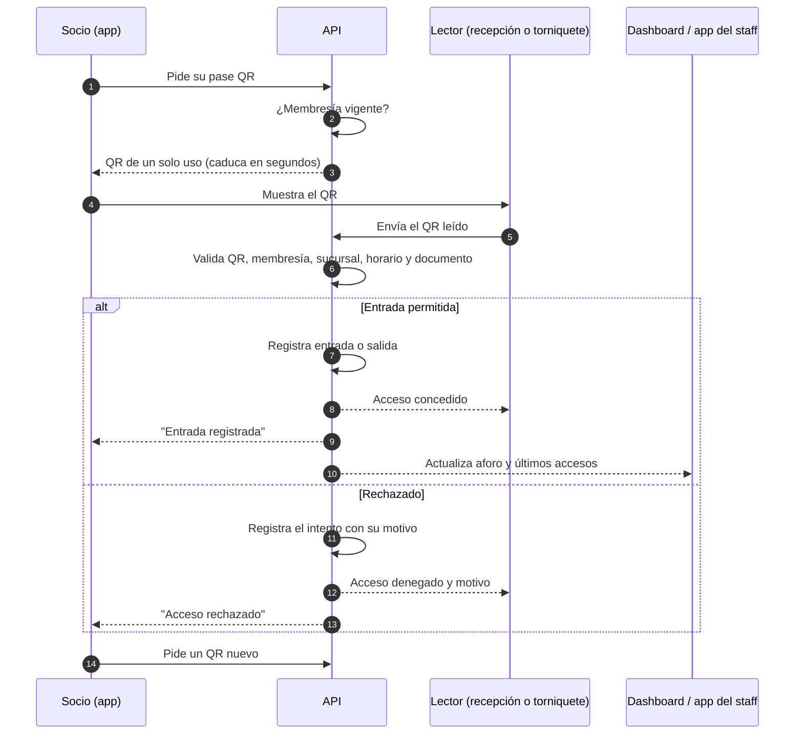

---

## 9. Procesos principales

### 9.1 Registro de un gimnasio (dueño)

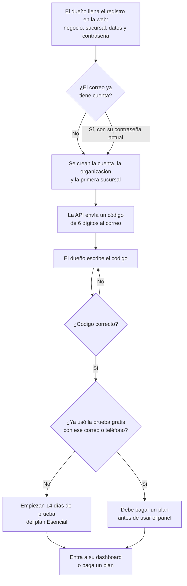

Detalles comprobados:

- La organización nueva queda **activa de inmediato** con su prueba; no espera aprobación.
- La prueba gratuita es **una por correo y por teléfono**. Empieza a contar cuando se confirma el correo.
- El código de verificación dura 15 minutos, admite 5 intentos y puede reenviarse cada 60 segundos.
- Si SIRID rechaza una organización, su dueño puede volver a registrarse con la misma cuenta; la solicitud entra a revisión de SIRID y no recibe otra prueba.

### 9.2 Alta de un socio

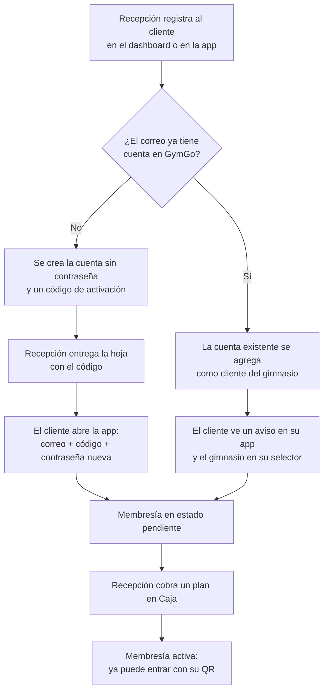

También puede unirse por su cuenta quien ya tiene la app, con el código o el QR de registro de la sucursal; queda con membresía pendiente hasta que recepción le venda un plan.

### 9.3 Inicio de sesión

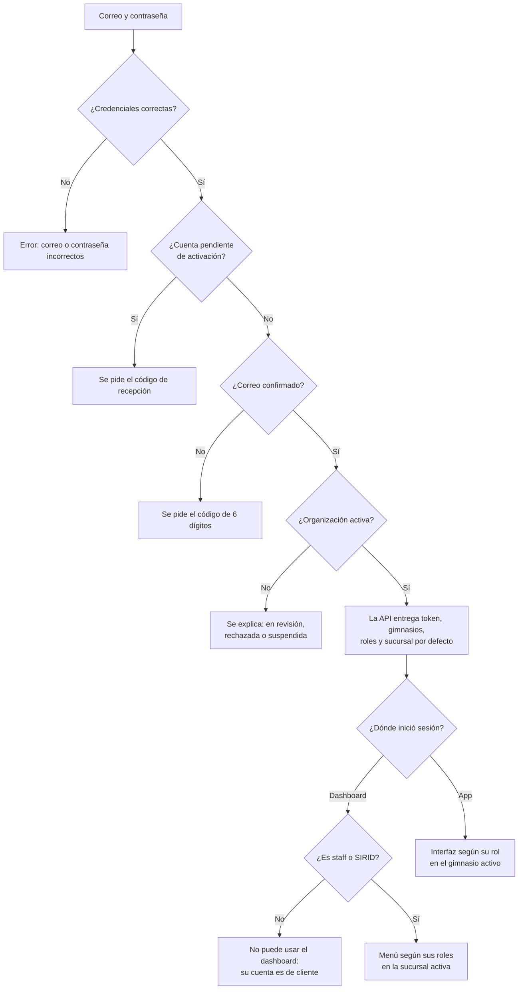

Para evitar intentos masivos, el inicio de sesión admite 10 intentos por cada 15 minutos.

### 9.4 Gestión de una membresía

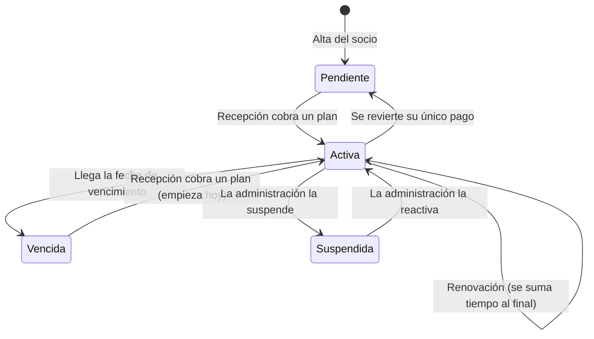

Qué ocurre exactamente al registrar un pago:

1. Se toma una "fotografía" de la membresía antes del cambio, para poder revertirlo.
2. Se copian a la membresía el plan y sus reglas de acceso (sucursales, horario, documento).
3. Se calcula el periodo: si la membresía sigue vigente, el tiempo nuevo **se suma al final**; si ya venció, empieza hoy.
4. La membresía queda activa con su nueva fecha de vencimiento.
5. El precio que se guarda para futuras renovaciones es el **precio de lista** del plan, no el precio con promoción.
6. Se avisa en vivo al socio y al staff.

Qué ocurre al **revertir** un pago: la membresía pierde el tiempo que ese pago todavía le daba y, si era el último pago, recupera el plan que tenía antes. El registro del pago permanece como "revertido".

Sobre los estados **Vencida** y **Suspendida**: el vencimiento se evalúa por fecha en cada acceso, así que una membresía cuya fecha pasó deja de abrir la puerta aunque nadie la haya marcado. 🟡 La suspensión existe en la API (solo administradores), pero no se encontró un botón para suspender en el dashboard ni en la app.

Efecto en el acceso: el pase QR solo se genera, y la puerta solo abre, con la membresía vigente. Un socio que ya está dentro siempre puede salir.

### 9.5 Pedido en la tienda

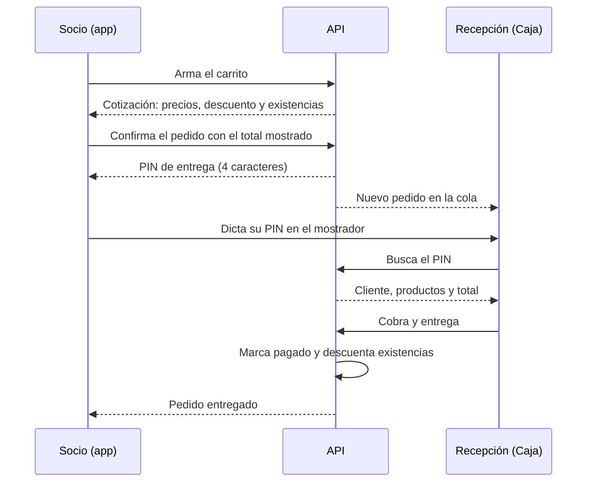

---

## 10. Escenarios reales de uso

Tres recorridos completos con datos de ejemplo. Los nombres son ficticios; todo lo que ocurre en ellos corresponde a funciones comprobadas en el código. Cada paso indica el módulo que interviene.

### 10.1 Escenario 1 — Gimnasio independiente

**Situación.** Laura abre "Fuerza Total", un solo local. Trabaja con una recepcionista (Marta) y un coach (Raúl). Plan GymGo: Esencial.

**A. Configuración inicial (una sola vez)**

| # | Quién | Dónde | Qué hace | Qué provoca |
|---|---|---|---|---|
| 1 | Laura | Web › Registro | Registra su negocio y su sucursal "Centro"; confirma su correo. | Organización activa con 14 días de prueba. Laura es Propietaria. |
| 2 | Laura | Dashboard › Gimnasios | Edita "Centro": zona horaria y aforo máximo. Imprime el QR de registro para el mostrador. | La zona horaria rige accesos, horarios y cortes. |
| 3 | Laura | Dashboard › Suscripciones | Crea los planes "Mensual" y "Estudiante" (este exige credencial verificada). | Aparecen en Caja y en la app de los socios. |
| 4 | Laura | Dashboard › Equipo | Registra sus máquinas con cantidades. | Se habilitan los ejercicios del catálogo global de esas familias. |
| 5 | Laura | Dashboard › Inventario | Crea productos con stock inicial. | Aparecen en Caja y en la tienda de la app. |
| 6 | Laura | Dashboard › Usuarios | "Agregar trabajador": Marta como Recepción y Raúl como Coach. | Cada uno ve solo sus módulos. |
| 7 | Laura | Web › Pagos | Antes de que termine la prueba, paga el plan Esencial. | 🧪 Pago simulado; el plan queda activo. |

**B. Operación diaria**

| # | Quién | Dónde | Qué hace | Qué provoca |
|---|---|---|---|---|
| 1 | Marta | Dashboard › Usuarios | Registra a un socio nuevo y le asigna a Raúl como coach. Imprime el código. | Cuenta creada; membresía pendiente. |
| 2 | Marta | Dashboard › Caja | "Cobrar membresía": plan Mensual en efectivo. | Membresía activa; el ingreso entra al corte. |
| 3 | Socio | App | Activa su cuenta con el código. | Entra al perfil Cliente. |
| 4 | Raúl | App › Crear | Arma la rutina del socio. | El socio la recibe en "Entrenar". |
| 5 | Socio | App › Acceso | Muestra su QR en la entrada. | Marta lo escanea; la entrada queda registrada. |
| 6 | Socio | App › Entrenar | Entrena y guarda la sesión. | Raúl la ve en el seguimiento del cliente. |
| 7 | Socio | App › Tienda | Pide una proteína; recibe un PIN. | El pedido entra a "Pendientes" de Caja. |
| 8 | Marta | Dashboard › Caja | Cobra el pedido con el PIN. | Se descuenta el stock de "Centro". |
| 9 | Marta | Dashboard › Movimientos | Al cierre, lee el "Corte de hoy" y cuenta el efectivo. | — |
| 10 | Laura | Dashboard › Inicio | Revisa ingresos, asistencias y membresías por vencer. | — |

**Módulos que intervienen y cómo se relacionan**

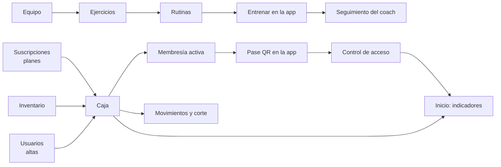

**Límites del plan Esencial en este escenario.** No hay aforo en vivo ni bitácora de accesos, ni documentos: el plan "Estudiante" con credencial verificada requeriría el plan Pro, porque la verificación de documentos es una función Pro. Tampoco puede abrir una segunda sucursal.

### 10.2 Escenario 2 — Cadena de gimnasios

**Situación.** "Titan Gym" tiene tres sucursales: **Norte**, **Centro** y **Sur**. Plan GymGo: Pro (hasta 3 sucursales).

**Personas y roles**

| Persona | Rol | Dónde | Qué ve |
|---|---|---|---|
| Diana | Propietaria | Toda la organización | Las tres sucursales, por separado o con "todas las sucursales". Único acceso a "Mi plan GymGo". |
| Jorge | Gerente | Norte | Solo Norte. |
| Elena | Gerente | Centro y Sur | Centro y Sur, por separado o en conjunto. No ve Norte. |
| Iván | Coach | Norte y Sur | Sus clientes asignados en esas dos sucursales. |
| Paola | Recepción | Centro | Mostrador de Centro. |
| Luis | Coach en Norte, Recepción en Sur | Dos sucursales, un rol distinto en cada una | En el dashboard, el menú cambia al cambiar de sucursal. En la app, ver la nota al final. |

**Qué se comparte y qué es propio de cada sucursal**

| Dato | Alcance | Consecuencia |
|---|---|---|
| Planes de membresía | Organización | Diana define un catálogo único. Cada plan indica qué sucursales abre: todas, solo la de origen o una lista. |
| Promociones | Organización | Iguales en las tres. |
| Catálogo de productos (nombre, precio) | Organización | Un mismo producto, un mismo precio. |
| **Existencias** de cada producto | Sucursal | Norte puede tener 10 y Sur 0. |
| Ejercicios propios | Organización | Disponibles para todos los coaches. |
| Rutinas y plantillas | Organización, visibles según el coach | — |
| Clientes | Organización, con una **sucursal de origen** | Un socio de Norte existe para toda la cadena; entrar a Sur depende de su plan. |
| Equipo y reportes de mantenimiento | Sucursal | — |
| Accesos, aforo y bitácora | Sucursal | Cada local cuenta su propia ocupación. |
| Cobros y corte de caja | Sucursal | Cada local hace su corte, en su zona horaria. |
| Staff | Sucursal | Los roles se asignan local por local. |
| Plan de GymGo | Organización | Uno solo, lo paga Diana. |

**Recorrido**

| # | Quién | Qué hace | Regla que se aplica |
|---|---|---|---|
| 1 | Diana | Abre Norte, Centro y Sur en Gimnasios. | Solo la propietaria abre sucursales; el plan Pro permite 3. Una cuarta mostraría el aviso de límite. |
| 2 | Diana | Nombra a Jorge y a Elena como Gerentes. | Solo la propietaria nombra gerentes. |
| 3 | Jorge | Agrega a Iván como Coach en Norte. | Un gerente gestiona Coach y Recepción de sus sucursales. |
| 4 | Jorge | Intenta crear un plan de membresía. | Rechazado: el catálogo es de la propietaria. Jorge solo lo consulta. |
| 5 | Diana | Crea "Titan Total" (todas las sucursales) y "Titan Local" (solo la de origen). | Las reglas se copian a la membresía al vender. |
| 6 | Paola | Registra en Centro a un socio y le cobra "Titan Local". | Su sucursal de origen es Centro. |
| 7 | Socio | Intenta entrar a Sur con su QR. | Rechazado: su plan no incluye esa sucursal. El intento queda en la bitácora de Sur. |
| 8 | Paola | Le cobra "Titan Total". | A partir de ese cobro puede entrar a las tres. |
| 9 | Socio | Entra a Norte sin haber registrado su salida de Centro. | El sistema cierra sola la visita de Centro. |
| 10 | Elena | Ajusta el stock de Sur. | Solo cambia Sur. No puede crear productos ni cambiar precios. |
| 11 | Diana | Elige "todas las sucursales" y abre Inicio y Movimientos. | Ve los datos de las tres juntos. |
| 12 | Diana | Abre Control de acceso › Aforo en vivo. | Ocupación de cada sucursal frente a su capacidad (función Pro). |

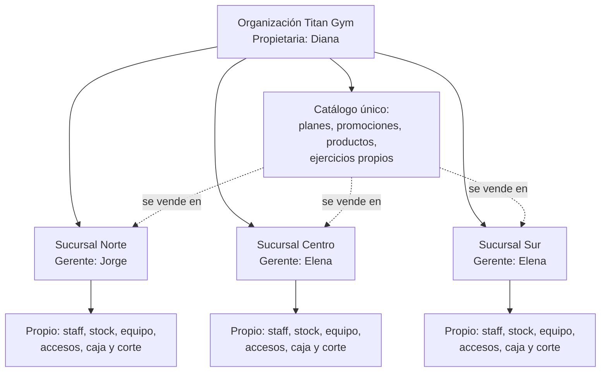

> **Nota sobre Luis (roles distintos por sucursal).** En el dashboard funciona como se espera: en Norte ve el menú de Coach y en Sur el de Recepción. En la **app**, la interfaz se decide por organización, no por sucursal: Luis ve la interfaz de Coach en ambas, y al seleccionar Sur la API le niega las operaciones de coach porque allí solo es Recepción. Para operar el mostrador de Sur desde el celular hoy necesitaría el dashboard. Ver G.1.

**Para una cadena de más de tres sucursales** se requiere el plan Cadena, que no se contrata en la web: lo activa SIRID desde su panel ajustando el plan y el límite de sucursales (ver 13.5).

### 10.3 Escenario 3 — Experiencia del socio

**Situación.** Ana se inscribe en la sucursal Centro de Titan Gym.

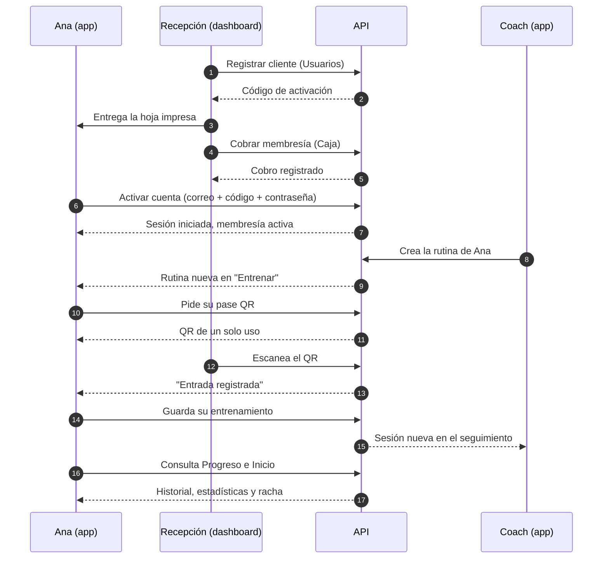

| Etapa | Qué hace Ana | Qué hace el gimnasio | Módulos | Resultado |
|---|---|---|---|---|
| **1. Registro** | Da sus datos en el mostrador. | Recepción: Usuarios › "+ Registrar cliente"; imprime el código. | Usuarios | Cuenta sin contraseña, membresía pendiente. |
| **2. Pago** | Paga en efectivo. | Recepción: "Cobrar membresía" › Caja. | Caja, Suscripciones, Movimientos | Membresía activa con fecha de vencimiento. |
| **3. Primer acceso a la app** | Instala GymGo y activa su cuenta con el código. | — | App (activación) | Entra al perfil Cliente. |
| **4. Rutina** | — | El coach asignado crea su rutina. | Rutinas, Ejercicios, Equipo | Ana la ve en "Entrenar" sin recargar. |
| **5. Acceso** | Abre **Acceso** y muestra su QR. | Recepción lo escanea. | Control de acceso | Entrada registrada; sube el aforo. |
| **6. Entrenamiento** | Registra series y guarda la sesión. | — | App (Entrenar), API (cálculos) | Resumen con volumen, calorías y mejores marcas. |
| **7. Seguimiento** | Revisa **Progreso** e **Inicio**. | El coach revisa Resumen, Progreso e Historial. | App del coach, Usuarios › Progreso | El coach ajusta la rutina. |
| **8. Renovación** | Semanas después: **Perfil** › Membresía y pagos › solicita el pago; recibe un PIN. | Recepción cobra con el PIN. | Caja | El tiempo nuevo se suma al final. |

**Variantes del mismo recorrido**

| Variante | Diferencia |
|---|---|
| Ana ya usaba GymGo en otro gimnasio | No hay código: recepción la vincula y Ana entra con su contraseña de siempre. Su historial anterior no se comparte sin su permiso. |
| Ana se une sola con el QR del mostrador | Queda como cliente con membresía pendiente; igualmente debe pagar en recepción. |
| La membresía de Ana vence | La app deja de generar el QR. Si vence estando dentro, puede salir. |
| Ana se queda sin señal al entrenar | La sesión se guarda en el teléfono y se envía después (7.5). |

**Lo que este recorrido no incluye, porque no existe:** que Ana se registre sola desde la app, que pague en línea, que reciba notificaciones push o que su membresía se renueve con cargo automático.

---

## 11. Sitio web público

Es la cara comercial de GymGo y la puerta de entrada de los dueños.

| Página | Función | Estado |
|---|---|---|
| Inicio | Información del producto y formulario de contacto. | ✅ |
| Precios | Planes Esencial, Pro y Cadena, leídos de la API. | ✅ |
| Demo | Solicitud de demostración. | ✅ |
| Registro | Alta del dueño, su organización y su primera sucursal. | ✅ |
| Iniciar sesión | Entrada con la cuenta de GymGo; lleva al panel o al checkout. | ✅ |
| Pagos | Checkout del plan: tarjeta, OXXO o PayPal, con desglose de IVA e historial. | 🧪 |
| Pago exitoso | Confirma el plan activo consultando la API. | ✅ |
| Contacto, ubicación, términos y privacidad | Páginas informativas y legales. | ✅ |

Los formularios de contacto y demo se envían por la API: el mensaje llega al correo de ventas de SIRID y el visitante recibe una copia. La web comparte la sesión con el dashboard, de modo que el dueño pasa de pagar a su panel sin volver a iniciar sesión.

---

## 12. El plan GymGo que paga el gimnasio

No debe confundirse con las membresías de los socios: este es el plan que **el gimnasio le paga a SIRID** por usar GymGo.

### 12.1 Planes

| Plan | Precio mensual | Precio anual | Sucursales | Incluye |
|---|---|---|---|---|
| **Esencial** | $699 + IVA | $6,990 + IVA | 1 | App para clientes y coaches con rutinas; membresías, cobros en recepción y tienda; acceso con QR desde la cámara de recepción. |
| **Pro** | $1,299 + IVA | $12,990 + IVA | Hasta 3 | Todo lo de Esencial más torniquetes IoT (software), aforo en vivo y bitácora, documentos y expedientes, e historial compartido entre gimnasios. |
| **Cadena** | A cotizar | A cotizar | 10 (ajustable) | Todo lo de Pro; hardware IoT con instalación, migración de datos y soporte dedicado. Lo vende el equipo de SIRID, no se contrata en la web. |

Los precios se cobran con IVA del 16 % desglosado (por ejemplo, Pro mensual: $1,299.00 + $207.84 = $1,506.84).

**Funciones exclusivas de Pro.** La API las niega a los planes que no las incluyen, sin importar lo que muestre la interfaz: torniquetes, aforo y bitácora, documentos e historial compartido.

### 12.2 Ciclo de vida del plan

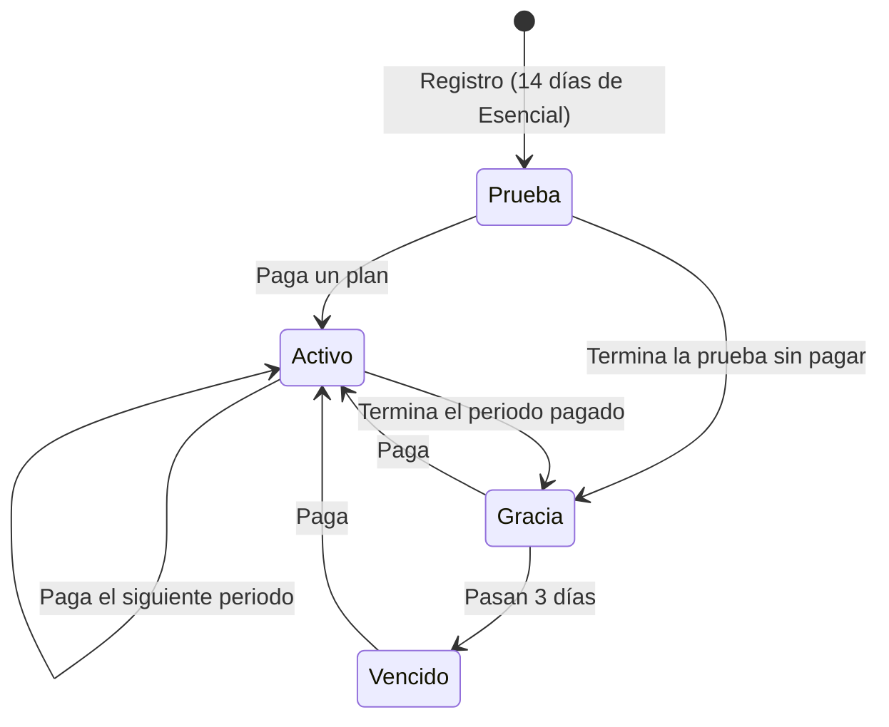

| Fase | Qué puede hacer el propietario | Qué pueden hacer staff y socios |
|---|---|---|
| **Al corriente** (prueba o pagado) | Todo | Todo |
| **Gracia** (3 días tras vencer) | Solo ver y pagar su plan | Siguen trabajando con normalidad |
| **Vencido** | Solo ver y pagar su plan | No pueden entrar; ven el gimnasio como suspendido. Los torniquetes dejan de responder. |

### 12.3 Formas de pago

| Forma | Estado | Comportamiento actual |
|---|---|---|
| **Tarjeta** | 🧪 Simulado | El formulario valida el número y el servidor decide si aprueba. Hay números de prueba para aprobar, rechazar o simular falta de fondos. Paga un periodo y no se renueva sola. Solo se guardan la marca y los últimos 4 dígitos. |
| **OXXO** | 🧪 Simulado | Genera una ficha con referencia de 14 dígitos y vencimiento a 3 días. Un botón "Simular pago en tienda" la marca como pagada. La ficha puede cancelarse. |
| **PayPal** | 🧪 Simulado | Una ventana pide correo y contraseña (no se validan con PayPal) y confirma el cargo. |
| **Stripe real** | 🟡 Programado, apagado | El código para cobrar con Stripe (tarjeta con renovación automática y OXXO) existe y se enciende con un ajuste del servidor. Hoy el sistema está en modo simulado. |
| **PayPal real** | ❌ | El código de la integración real está desactivado. |

Mientras el sistema esté en modo simulado, la web lo indica con la etiqueta "Pagos simulados" y aclara que no se hace ningún cargo real.

---

## 13. Administración central de SIRID Systems

El panel central es la parte del dashboard reservada al personal de SIRID. Completa lo resumido en 4.19.

### 13.1 Acceso al panel

| | |
|---|---|
| **Quién** | Cuentas marcadas como administrador de plataforma. |
| **Cómo se concede** | Solo con un script del servidor: `npm run platform:admin correo@ejemplo.com` (y `--revoke` para retirarlo). ❌ No hay pantalla para dar o quitar este permiso. |
| **Dónde** | `/dashboard/platform` (Organizaciones) y `/dashboard/platform/exercises` (Catálogo global). El menú muestra la sección "SIRID". |
| **Qué ve** | Por privacidad, "solo ves conteos y el contacto del propietario": nunca la lista de personas de un gimnasio. |

El personal de SIRID no pertenece a ninguna organización. Si además elige una sucursal en el selector, la API lo trata como propietario de esa organización, esté activa o no.

### 13.2 Registro de organizaciones

SIRID **no registra** organizaciones: se registran solas (5.1.1). Lo que importa para SIRID es el estado en que quedan:

| Origen del registro | Estado inicial | ¿Requiere acción de SIRID? |
|---|---|---|
| Registro normal en la web o en `/dashboard/signup` | **Activa**, con prueba de 14 días | No |
| Registro con correo o teléfono que ya usó la prueba | **Activa**, sin prueba: debe pagar un plan | No |
| Una organización **rechazada** que vuelve a registrarse con la misma cuenta | **En revisión** (pendiente) | Sí: aprobar o rechazar |

❌ **No implementado:** crear una organización desde el panel de SIRID a nombre de un cliente.

### 13.3 Revisión y aprobación

| | |
|---|---|
| **Objetivo** | Decidir sobre las organizaciones en revisión y controlar el estado de las demás. |
| **Rol responsable** | Personal de SIRID. |
| **Ubicación** | SIRID › **Organizaciones**, pestañas "Pendientes", "Activas", "Suspendidas", "Rechazadas" y "Todas". |

**Pasos**

1. Abrir la pestaña "Pendientes".
2. Revisar la tarjeta de la organización: nombre, razón social y RFC, fecha de la solicitud, datos del propietario (nombre, correo, teléfono) y sus sucursales.
3. Confirmar la solicitud por teléfono con el propietario.
4. Pulsar "Aprobar" o "Rechazar". Para rechazar, escribir el "Motivo (lo verá el propietario)".

**Transiciones permitidas** (las aplica la API; cualquier otra se rechaza)

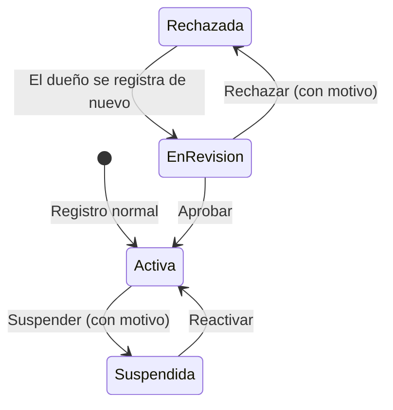

| Acción | Desde | Efecto, según el propio panel |
|---|---|---|
| **Aprobar** | En revisión | "El propietario podrá entrar y crear su gimnasio de inmediato." |
| **Rechazar** | En revisión | "El propietario verá el motivo al iniciar sesión y podrá enviar la solicitud de nuevo." |
| **Suspender** | Activa | "Nadie de la organización podrá entrar, incluidos sus torniquetes, hasta que la reactives." |
| **Reactivar** | Suspendida | "El equipo y los clientes podrán volver a entrar." |

**Validaciones**

- Rechazar y suspender exigen un motivo (máximo 500 caracteres). Solo lo ve el propietario; el staff y los socios ven un mensaje genérico.
- Una organización rechazada no puede aprobarse directamente: su dueño debe volver a registrarse.
- Una organización en revisión no puede suspenderse.

### 13.4 Administración de gimnasios registrados y consulta de organizaciones y sucursales

| Operación | Pasos | Resultado |
|---|---|---|
| **Buscar una organización** | Escribir en el buscador "Nombre, razón social o RFC" y elegir la pestaña de estado. | Lista filtrada (hasta 500 resultados), con el número de organizaciones por estado. |
| **Consultar su tamaño** | Leer la tarjeta. | Conteos de "Sucursales" (abiertas / límite), "Personal", "Clientes" y "Membresías activas". |
| **Consultar sus sucursales** | Desplegar la lista de sucursales de la tarjeta. | Nombre y dirección de cada una; las inactivas se marcan "(inactiva)". |
| **Contactar al propietario** | Leer el bloque "Propietario". | Nombre, correo y teléfono. |
| **Ver el motivo del estado** | Leer "Motivo" en la tarjeta. | El texto escrito al rechazar o suspender. |

### 13.5 Gestión de planes y restricciones

#### 13.5.1 Cambiar el límite de sucursales

1. En la tarjeta de la organización, ubicar "Límite de sucursales".
2. Escribir el nuevo valor (de 1 a 100) y guardar.

**Resultado.** El propietario puede abrir sucursales hasta ese número. **Validación:** bajar el límite no cierra las sucursales ya abiertas; solo impide abrir más.

#### 13.5.2 Cambiar el plan de GymGo de una organización

1. En el bloque "Plan GymGo" de la tarjeta, abrir el cambio de plan.
2. Elegir el "Tipo de cambio":

| Opción | Cuándo se usa | Datos que pide |
|---|---|---|
| **Extender prueba** | "Da más días de prueba con el plan actual." | Fecha en que termina la prueba. |
| **Pagado hasta** | "Pagó fuera de la web (transferencia, efectivo) hasta una fecha." | Plan, fecha de fin del periodo y, opcionalmente, límite de sucursales. |
| **Plan manual** | "Vendido por SIRID (Cadena, IoT). No vence hasta que lo cambies." | Plan y, opcionalmente, límite de sucursales. |

3. Guardar. "El dueño y su equipo ven el cambio al instante."

**Validaciones**

- Las fechas deben estar en el futuro.
- Si no se indica límite de sucursales, se aplica el del plan elegido.
- Si la organización paga con tarjeta y renovación automática, el cambio se bloquea: "cancélala en Stripe antes de cambiar el plan" (aplica solo con Stripe encendido).
- "Extender prueba" no está disponible si la organización no tiene plan.
- Las organizaciones creadas antes de la facturación aparecen como "Sin plan: … tiene todos los módulos y no vence".

**Restricciones que se derivan del plan** (las aplica la API, no la interfaz): número de sucursales, y las funciones Pro —torniquetes, aforo y bitácora, documentos e historial compartido— (ver 12.1).

### 13.6 Catálogo global de ejercicios

| Operación | Pasos | Resultado y validaciones |
|---|---|---|
| **Buscar** | Filtrar por nombre, músculo, equipo, estado (Visibles/Ocultos) y origen (Dataset/SIRID). | — |
| **Crear** | "Nuevo ejercicio SIRID": nombre, músculo principal, categoría de equipo, músculos secundarios, métrica, "GIF de la técnica", miniatura y pasos. | "Nombre, músculo y GIF son obligatorios." Archivos de hasta 5 MB. |
| **Editar** | Botón de edición de la fila. | Los campos modificados quedan **bloqueados**: la carga del dataset ya no los sobrescribe. Se pueden desbloquear uno por uno. |
| **Ocultar o mostrar** | Botón del ojo. | Un ejercicio oculto deja de ofrecerse a los gimnasios. |

🟡 La subida de imágenes depende de que el almacén público de archivos esté configurado en el servidor.

### 13.7 Funciones existentes y no implementadas

| Función del panel central | Estado |
|---|---|
| Listar y buscar organizaciones por estado | ✅ |
| Ver conteos, datos fiscales, propietario y sucursales | ✅ |
| Aprobar, rechazar, suspender y reactivar | ✅ |
| Cambiar el límite de sucursales | ✅ |
| Extender prueba, registrar pago externo y activar plan manual | ✅ |
| Editar el catálogo global de ejercicios | ✅ |
| Dar o quitar el permiso de administrador de plataforma | 🟡 Solo por script del servidor |
| Crear una organización a nombre de un cliente | ❌ |
| Editar los datos de una organización (nombre, RFC, propietario) | ❌ |
| Eliminar una organización o una sucursal | ❌ |
| Editar el catálogo de planes de GymGo (precios, funciones) desde el panel | ❌ Los planes se definen en el servidor |
| Ver el historial de pagos de GymGo de cada organización | ❌ El panel muestra el estado del plan, no los pagos |
| Reportes de ingresos de SIRID, métricas de la plataforma | ❌ |
| Ver o administrar a las personas de un gimnasio desde el panel | ❌ Excluido a propósito por privacidad |
| Bitácora de las acciones del personal de SIRID | 🟡 Se guarda quién aprobó y cuándo; no hay pantalla que lo muestre |
| Avisar al propietario por correo cuando cambia su estado | ❌ El cambio de estado no envía correo; el propietario lo ve al iniciar sesión |

---

## 14. Preguntas frecuentes

**¿Qué puede hacer el administrador?**
"Administrador" agrupa al Propietario y al Gerente. Ambos operan sucursales, usuarios, accesos, caja, pagos, inventario, equipo, mantenimiento, rutinas y documentos. El propietario lo hace en toda la organización; el gerente, en sus sucursales.

**¿Qué diferencia hay entre el propietario y el gerente de una sucursal?**
El propietario es dueño de todo el negocio: abre sucursales, define el catálogo (planes, promociones y productos), nombra gerentes y paga el plan de GymGo. El gerente dirige una o varias sucursales: administra su personal (excepto otros gerentes), su inventario y su operación diaria, pero no cambia el catálogo ni ve la facturación de GymGo. Tabla completa en 2.3.

**¿Un usuario puede ser entrenador y socio al mismo tiempo?**
Sí, en gimnasios distintos: la misma cuenta puede ser coach en uno y socia en otro, y cambia con el selector de gimnasio. En el mismo gimnasio, el formulario de usuarios no permite combinar Cliente con roles de staff; solo conviven si la persona se une con el código de registro, y aun así la app le muestra únicamente la interfaz de coach. Detalle en 2.4 y 2.5.

**¿Cómo administra una cadena varias sucursales?**
El propietario abre cada sucursal (hasta el límite de su plan), con su zona horaria y aforo. Asigna gerentes, coaches y recepción por sucursal. Define un catálogo único de planes, promociones y productos para toda la organización, mientras que el inventario, el equipo, los accesos y la caja se llevan por sucursal. Puede ver todo en conjunto con la vista "todas las sucursales". Un plan de membresía puede dar acceso a todas las sucursales, solo a la de origen o a una lista.

**¿Qué puede hacer un entrenador desde el dashboard?**
Ver Inicio, administrar Equipo, consultar Mantenimiento, gestionar Ejercicios y Rutinas, y consultar en Usuarios a sus clientes asignados con su progreso y observaciones. No ve pagos, caja, inventario ni clientes de otros coaches.

**¿Qué puede hacer un socio desde la aplicación?**
Ver y realizar su rutina, registrar sus entrenamientos (incluso sin conexión), consultar historial y estadísticas, entrar con su pase QR, ver su membresía y solicitar un pago, comprar en la tienda, subir documentos, reportar fallas y decidir quién ve su historial.

**¿Cómo se controla el acceso al gimnasio?**
El socio muestra un QR de un solo uso que caduca en segundos. El staff lo lee con una cámara o con la app, y la API comprueba membresía vigente, sucursal incluida, horario y documento. Cada entrada, salida y rechazo queda en la bitácora. El servidor está preparado para torniquetes autónomos, pero el proyecto no incluye el hardware. Detalle en la sección 8.

**¿Cómo se conectan los registros de la aplicación con el dashboard?**
Ambos usan la misma API y la misma base de datos. Lo que el socio registra en la app queda guardado en el servidor y un canal en vivo avisa a las pantallas abiertas. No hay sincronización manual ni copias separadas. Detalle en el anexo B.

**¿Qué sucede cuando se registra un pago o se modifica una membresía?**
El pago queda registrado, la membresía se activa o se extiende (sumando el tiempo al final si aún estaba vigente), se copian las reglas de acceso del plan, se avisa al socio en su app y se actualizan los indicadores del dueño y el corte de caja. A partir de ese momento su QR abre la puerta. Detalle en 9.4.

---

## 15. Diccionario de términos

| Término | Definición en GymGo |
|---|---|
| **Activación de cuenta** | Paso en el que un socio dado de alta en recepción crea su contraseña con su correo y un código. |
| **Administrador (Admin)** | Nombre común de Propietario y Gerente cuando el sistema decide permisos. No es un rol que se asigne. |
| **Aforo** | Personas dentro de una sucursal en este momento, frente a su capacidad máxima. |
| **Alta rápida** | Registro básico de un cliente desde la app del staff. |
| **Bitácora de accesos** | Historial de entradas, salidas y rechazos de una sucursal. |
| **Bloque** | Unidad de una rutina: uno o varios ejercicios con sus series y su descanso. |
| **Catálogo** | Lo que la organización vende o usa en común: planes, promociones y productos. Lo administra el propietario. |
| **Catálogo global** | Ejercicios que SIRID mantiene para todos los gimnasios. |
| **Cliente / Socio** | Persona inscrita en un gimnasio. "Cliente" es el nombre del rol; "socio" se usa en Caja y en este manual como sinónimo. |
| **Coach asignado** | Entrenador responsable de un cliente; determina qué clientes ve cada coach. |
| **Código de activación** | Código de 8 caracteres, de un solo uso y válido 30 días, que recepción entrega al socio nuevo. |
| **Código de registro (código para unirse)** | Código de 8 caracteres de una sucursal, también en QR, con el que una cuenta existente se une al gimnasio. |
| **Código de verificación** | Código de 6 dígitos enviado por correo para confirmar la cuenta de un dueño. |
| **Corte de caja** | Resumen de lo cobrado en el día por forma de pago, tipo y persona. En GymGo es una consulta, no un cierre. |
| **Cotización** | Cálculo que hace el servidor del total de un cobro: precios, promociones y existencias. |
| **Esfuerzo percibido** | Escala de 1 a 5 con la que el socio califica qué tan pesado fue su entrenamiento. |
| **Expediente del personal** | Documentos laborales de un empleado (plan Pro). |
| **Gerente** | Encargado de una o varias sucursales. |
| **Gracia** | Los 3 días posteriores al vencimiento del plan de GymGo en los que el gimnasio sigue operando. |
| **Historial compartido** | Entrenamientos de un socio en otra organización, visibles solo con su permiso. |
| **Invitación al staff** | Propuesta para que una cuenta existente trabaje en un gimnasio; la persona la acepta o rechaza en su app. |
| **Membresía** | Derecho de un socio a entrar al gimnasio durante un periodo. No confundir con el plan de GymGo. |
| **Modo piso** | Interfaz reducida de la app para el staff de mostrador: escanear, cobrar y dar de alta. |
| **Movimiento** | Registro comercial: un pago de membresía, un pedido de tienda o un ajuste de inventario. |
| **Organización** | El negocio de un dueño, con una o varias sucursales. Es la frontera de los datos. |
| **Pase QR** | Código que el socio muestra para entrar; de un solo uso y de corta duración. |
| **Pedido** | Compra en la tienda hecha desde la app, que se paga y entrega en recepción. |
| **PIN de pago** | 5 dígitos que identifican una solicitud de pago de membresía. |
| **PIN de entrega** | 4 caracteres que identifican un pedido de tienda. |
| **Plan de GymGo** | Suscripción que el gimnasio paga a SIRID: Esencial, Pro o Cadena. |
| **Plan de membresía** | Producto que el gimnasio vende a sus socios, con precio, duración y reglas de acceso. |
| **Plantilla** | Rutina base sin cliente, reutilizable. Asignarla crea una copia. |
| **Promoción** | Descuento en porcentaje aplicable a planes o productos durante una vigencia. |
| **Propietario** | Dueño de la organización; quien la registró. |
| **Prueba gratuita** | 14 días del plan Esencial al registrar un gimnasio; una por correo y por teléfono. |
| **Racha** | Días programados consecutivos en los que el socio asistió, según sus entradas por QR. |
| **Recepción** | Personal de mostrador. |
| **Reversión** | Deshacer un pago cobrado: quita a la membresía el tiempo que daba. No es un reembolso. |
| **Rutina asignada** | Programa de entrenamiento de un cliente concreto. |
| **Solicitud de pago** | Petición que el socio genera en la app para pagar su membresía en recepción con un PIN. |
| **Sucursal (gimnasio)** | Un local de la organización. En el menú del dashboard se llama "Gimnasios". |
| **Sucursal activa** | La sucursal en la que se está trabajando; define qué datos se ven. |
| **Sucursal de origen** | Sucursal en la que un cliente se inscribió. |
| **Superserie** | Bloque con dos o más ejercicios que se alternan. |
| **Torniquete** | Lector de acceso autónomo registrado con una llave propia. |
| **Tráfico de equipos** | Estimación de qué tan ocupado está cada aparato. |
| **Volumen** | Suma de repeticiones por peso de un entrenamiento. |

---

## Anexo A. Arquitectura general

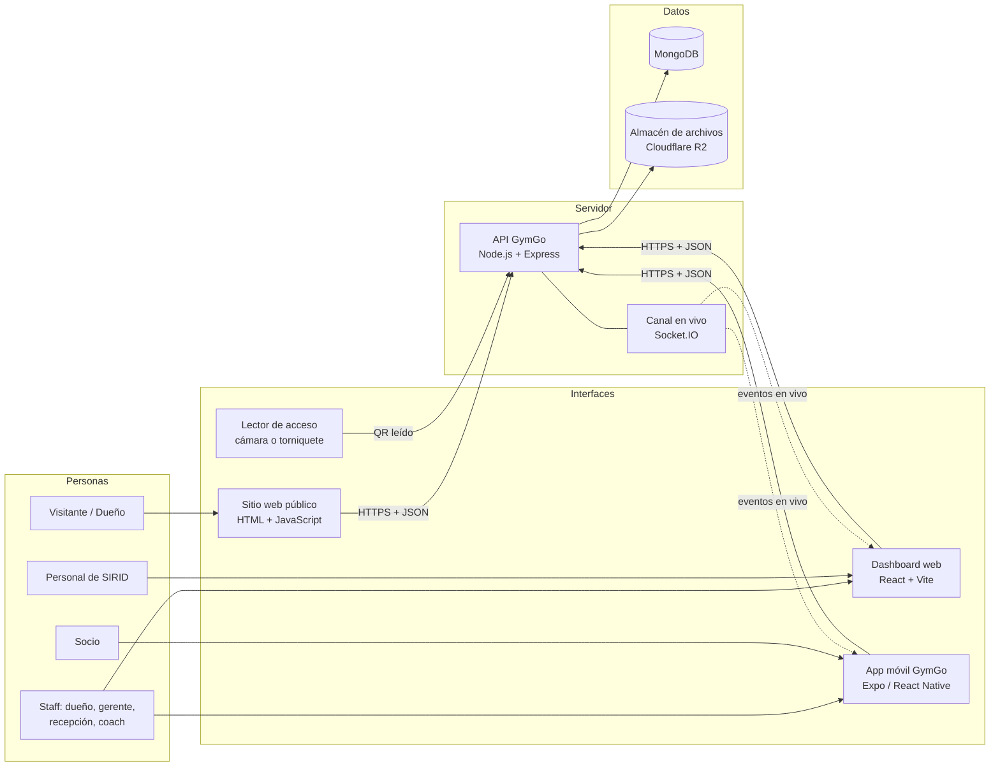

**Puntos clave de la arquitectura.**

- **Una sola API y una sola base de datos.** El dashboard, la app y la web no se comunican entre sí: todos hablan con la API. Por eso un cambio hecho en uno aparece en los demás.
- **Sesión con token.** Al iniciar sesión, la API entrega un token firmado (JWT) que la interfaz envía en cada petición. Por defecto dura 1 hora.
- **Sucursal activa.** El dashboard y la app envían en cada petición la sucursal en la que se está trabajando. La API responde solo con los datos de esa sucursal y con los permisos que la persona tiene en ella.
- **Canal en vivo.** Además de las peticiones normales, el dashboard y la app mantienen una conexión abierta por la que la API avisa de cambios (un pago, una entrada, un reporte) sin recargar la pantalla.
- **Archivos privados.** Los documentos (credenciales, expedientes) no se guardan en la base de datos sino en un almacén de archivos privado; la API entrega enlaces temporales para verlos.

**Tecnología utilizada** (según los archivos de dependencias):

| Capa | Tecnología |
|---|---|
| API | Node.js, Express 5, Mongoose 8 (MongoDB), Socket.IO, JWT, validación con Zod |
| Dashboard | React 19, Vite, Tailwind CSS, React Router |
| App móvil | Expo SDK 58, React Native 0.88, Expo Router |
| Web pública | HTML, Bootstrap 5.3 y JavaScript sin framework |
| Correo | Brevo (API HTTP) o SMTP, según configuración |

---

## Anexo B. Integración entre componentes

### B.1 Cómo viaja la información

1. Una persona hace algo en una interfaz (cobra, entrena, escanea).
2. La interfaz envía la operación a la API, con el token de sesión y la sucursal activa.
3. La API comprueba quién es, qué rol tiene en esa sucursal y si las reglas del negocio lo permiten.
4. La API guarda el cambio en MongoDB. Las operaciones que tocan varios registros (un cobro con membresía y productos, una entrada) se guardan como una unidad: todo o nada.
5. La API emite un evento por el canal en vivo, dirigido solo a quienes deben verlo.
6. Las interfaces abiertas reciben el evento y recargan el dato afectado.

### B.2 A quién le llegan los avisos en vivo

La API reparte los eventos por "salas" según el rol de cada conexión: propietarios de la organización, administradores, todo el staff, gerentes de una sucursal, recepción de una sucursal, coaches de una sucursal y la sala personal de cada usuario. Las organizaciones que no están activas no reciben eventos.

| Evento | Se emite cuando… | Lo reciben |
|---|---|---|
| Acceso registrado | Se escanea un QR (entrada, salida o rechazo) | El socio; propietarios, gerentes y recepción de la sucursal |
| Pago actualizado | Se solicita, cobra, cancela o revierte un pago | El socio y el staff de mostrador |
| Venta actualizada | Se crea, cobra o cancela un pedido de tienda | El socio y el staff de mostrador |
| Directorio actualizado | Alta, activación, cambio de roles, coach o membresía | El staff y la persona afectada |
| Rutina actualizada | Se crea o modifica una rutina | El cliente asignado y quien la creó; si es una plantilla sin cliente, el staff |
| Mantenimiento actualizado | Se crea o atiende un reporte | Propietarios, gerentes, coaches y quien reportó |
| Documento actualizado | Se sube o revisa un documento | El titular y el staff |
| Historial compartido | Se solicita, aprueba, rechaza o revoca | El socio y el staff del gimnasio solicitante |
| Invitación al staff | Se crea, acepta, rechaza o cancela | La persona invitada y los administradores |
| Alta de cliente | Recepción agrega una cuenta existente | La persona dada de alta |
| Suscripción actualizada | Cambia el plan de GymGo | El propietario |

### B.3 Diagrama de interacción entre usuarios y plataformas

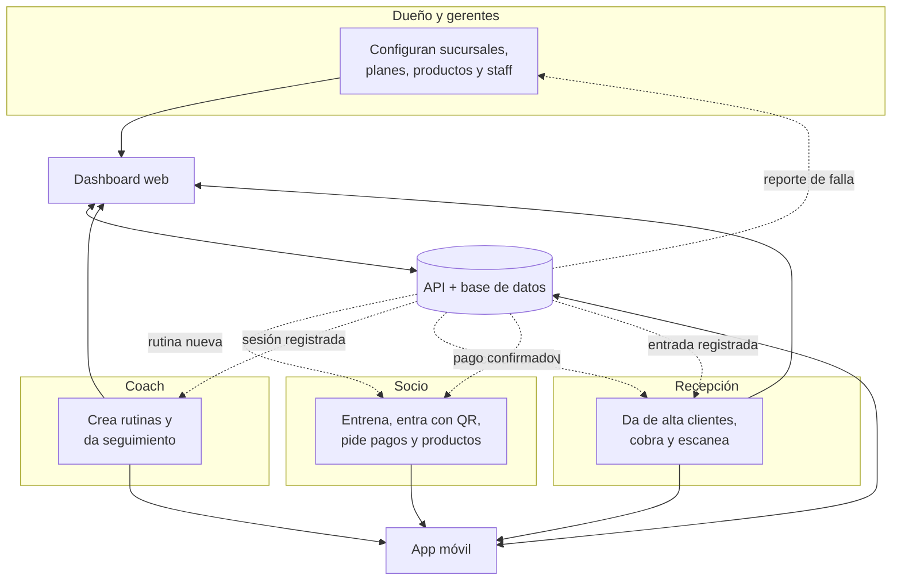

### B.4 Ejemplos prácticos

**Ejemplo 1 — Una rutina, del coach al socio y de vuelta.**
El coach crea una rutina en el dashboard y la asigna a Ana. La API la guarda y avisa a Ana, cuya app la muestra en "Entrenar" sin recargar. Ana entrena y guarda su sesión. La API calcula volumen y calorías, y el coach ve la sesión nueva en la pestaña Historial de Ana y sus indicadores actualizados en Resumen.

**Ejemplo 2 — Un cobro en recepción.**
Bruno pide en su app pagar su renovación y recibe un PIN. En el mostrador dicta el PIN; recepción lo busca en Caja, confirma el monto y cobra. La API extiende la membresía de Bruno, le avisa "Pago confirmado" en su app, actualiza el contador de pendientes en el Inicio del staff y suma el ingreso al panel del dueño y al corte de caja.

**Ejemplo 3 — Una falla de equipo.**
Carla reporta desde la app que una caminadora se detiene sola. El reporte aparece en vivo en Mantenimiento. El gerente lo marca "en proceso" y saca una unidad de servicio. El módulo Equipo muestra una unidad menos disponible, la app de los socios marca el aparato "en mantenimiento" y el editor de rutinas avisa al coach que ese equipo tiene fallas. Carla ve el cambio de estado en "Mis reportes".

**Ejemplo 4 — Un socio que entrena en dos gimnasios.**
Diego es socio de dos organizaciones. Su entrenador nuevo solicita ver su historial. Diego recibe el aviso, acepta y decide no compartir sus datos sensibles. El coach ve sus entrenamientos anteriores en solo lectura. Si Diego retira el permiso, el historial desaparece del dashboard del gimnasio en ese momento.

---

## Anexo C. Estado de implementación

### C.1 Implementado de extremo a extremo

- Registro de dueños con verificación de correo y periodo de prueba.
- Organizaciones con varias sucursales, zonas horarias y aforo.
- Roles por organización y por sucursal, con permisos aplicados en la API.
- Alta de clientes con código de activación; invitaciones al staff; unión por código o QR.
- Planes de membresía con reglas de sucursal, horario y documento.
- Promociones para tienda y membresías.
- Caja con cobro combinado, cotización en servidor y protección contra cobros dobles.
- Solicitudes de pago y pedidos de tienda con PIN.
- Movimientos y corte de caja por sucursal y zona horaria.
- Inventario por sucursal con historial de movimientos.
- Equipo, reportes de mantenimiento y catálogo de ejercicios (global y propio).
- Rutinas por bloques, plantillas y asignación.
- Registro de entrenamientos, también sin conexión, con estadísticas y mejores marcas.
- Seguimiento de clientes para el coach, con alertas.
- Acceso por QR de un solo uso validado por el staff, con bitácora y aforo.
- Actualización en vivo entre dashboard y app.
- Panel de SIRID para organizaciones y catálogo global.
- Sitio web con precios, registro, checkout y formularios de contacto.

### C.2 Parcial, simulado o no implementado

| Funcionalidad | Estado | Explicación |
|---|---|---|
| Pago del plan GymGo (tarjeta, OXXO, PayPal) | 🧪 | Flujo completo sin proveedor real; ver 12.3. |
| Cobro con Stripe | 🟡 | Programado; desactivado por configuración. |
| Torniquetes y lectores autónomos | 🟡 | El servidor los admite; no hay firmware ni simulador en el proyecto. |
| Hardware IoT con instalación | ❌ | Es parte de la oferta del plan Cadena, no del software. |
| Pago en línea de la membresía del socio | ❌ | La app lo declara "aún no conectado"; se paga en recepción. |
| Método de pago en Caja (tarjeta, transferencia) | 🟡 | Se registra como dato; no se procesa el cargo. |
| Registro de clientes por cuenta propia | 🟡 | Existe en la API; ninguna interfaz lo ofrece. |
| Notificaciones push | ❌ | Solo hay avisos dentro de la app. |
| Tráfico de equipos | 🟡 | Es una estimación a partir de entrenamientos recientes, no de sensores. |
| Renovación automática de membresías de socios | 🟡 | El plan guarda el dato "se renueva sola", pero no hay un cobro automático: cada periodo se cobra en recepción. |
| Suspender una membresía | 🟡 | La API lo permite a administradores; ninguna interfaz lo ofrece. |
| Reembolsos | ❌ | Revertir un pago quita tiempo de membresía; no registra devolución de dinero. |
| Caducidad y límite de pedidos pendientes | 🟡 | La regla está programada pero sin valor asignado: hoy un pedido pendiente no caduca. |
| Documentos y expedientes | 🟡 | Funcional; depende de que el almacén de archivos esté configurado en el servidor. |
| Envío de correos | 🟡 | Funcional; depende del servicio de correo configurado en el servidor. |
| Permisos del gerente sobre el catálogo | 🟡 | Restringidos al propietario a la espera de una decisión de negocio. |
| Sustitución de ejercicios | ❌ | Aparece en el README del proyecto; no se encontró en el código. |

> **Nota sobre documentos anteriores.** El archivo `README.md` del repositorio describe el sistema con tres perfiles (Administrador, Coach, Cliente) y menciona funciones como la sustitución de ejercicios. Refleja una etapa previa: el sistema actual tiene cinco roles con sucursales, y no todo lo que el README enumera está en el código. Este manual describe el estado real.

### C.3 Estado real del hardware

- ✅ **Lo que existe:** la API acepta dispositivos de acceso. Cada uno se registra en el dashboard, queda ligado a una sucursal y se identifica con una llave propia que puede revocarse. La API registra su última conexión y deja de atenderlo si el gimnasio no tiene el plan Pro o no está al corriente.
- ❌ **Lo que no está en el proyecto:** no hay código de firmware, ni programa del lector, ni un simulador de torniquete en los repositorios revisados. El propio plan lo describe como "Torniquetes IoT (software)" y reserva el "hardware IoT con instalación" para el plan Cadena, que vende SIRID directamente.

En resumen: el lado del servidor para un torniquete está construido y probado con pruebas automáticas, pero lo que hoy funciona de extremo a extremo es la de la cámara de recepción y la app del staff.

---

## Anexo D. Matriz de responsabilidades y módulos

Relaciona cada módulo con quien lo usa, las piezas técnicas que lo forman y lo que intercambia con los demás. Los componentes técnicos se nombran por archivo o carpeta: **D** = dashboard (`dashboard/src/pages`), **A** = app (`src/features/gymgo`), **API** = controlador o utilidad de `api/src`.

| Módulo | Función | Roles involucrados | Componentes técnicos | Información que recibe | Información que genera | Dependencias | Estado |
|---|---|---|---|---|---|---|---|
| **Registro y sesión** | Alta de dueños, inicio de sesión, activación y verificación de correo | Todos | Web `registro.js`, `login.js` · D `Login`, `Signup` · A `auth-screen`, `activate-account-screen`, `verify-email-screen` · API `auth`, `organization` | Correo, contraseña, códigos | Token de sesión, lista de gimnasios y roles | Servicio de correo | ✅ |
| **Organizaciones y sucursales** | Estructura del negocio y códigos de registro | Propietario, Gerente; Recepción consulta | D `Gyms` · A `gym-switcher`, `join-gym-screen` · API `gym`, `tenant` | Nombre, zona horaria, aforo | Sucursales, código y QR de registro | Plan GymGo (límite) | ✅ |
| **Usuarios y roles** | Directorio de clientes y staff, invitaciones | Propietario, Gerente; Recepción y Coach con límites | D `Users`, `ClientEnrollmentModal`, `StaffInvitationsPanel` · A `quick-enroll-screen`, `staff-invitations-screen` · API `user`, `client-enrollment`, `staff-invitation` | Datos personales, roles, coach asignado | Cuentas, códigos de activación, invitaciones | Sucursales | ✅ |
| **Planes de membresía** | Qué vende el gimnasio y con qué reglas | Propietario; Gerente y Recepción consultan | D `Subscriptions` · API `plan`, `access-rules` | Precio, duración, sucursales, horario, documento | Catálogo de planes | — | ✅ |
| **Promociones** | Descuentos a planes y productos | Propietario; el socio las ve | D `Promotions` · A `store-screen` · API `promotion`, `membership-pricing`, `store-pricing` | Porcentaje, vigencia, alcance | Descuentos aplicables | Planes, productos, documentos | ✅ |
| **Caja** | Cobro de membresías, productos y pedidos | Propietario, Gerente, Recepción | D `Cashier` · A `cashier-screen`, `payment-desk`, `order-desk` · API `cashier`, `payment-operations`, `order-operations`, `idempotency` | Socio, plan, productos, PIN, forma de pago | Pagos, ventas, membresías activadas, descuento de stock | Planes, promociones, inventario, usuarios | ✅ (tarjeta y transferencia: 🟡 solo registro) |
| **Pagos** | Consulta y corrección de pagos | Propietario, Gerente; Recepción cancela | D `Payments` · A `client-billing` · API `payment`, `membership` | Solicitudes y cobros | Cancelaciones, reversiones | Caja, membresías | ✅ (reembolsos: ❌) |
| **Movimientos y corte** | Historial comercial y resumen del día | Propietario, Gerente, Recepción | D `Movements` · API `commercial` | Pagos, pedidos, ajustes de stock | Totales por método, tipo y persona | Caja, inventario, zona horaria | ✅ (cierre de corte: ❌) |
| **Inventario y tienda** | Catálogo, existencias y pedidos | Propietario, Gerente; el socio compra | D `Inventory` · A `store-screen`, `cart-modal`, `orders-modal` · API `inventory`, `store`, `store-order` | Productos, ajustes, carritos | Existencias, movimientos, pedidos con PIN | Sucursales, promociones, Caja | ✅ |
| **Control de acceso** | Entradas, salidas, aforo y bitácora | Propietario, Gerente, Recepción; el socio presenta su QR | D `Access`, `OccupancyMonitor`, `AccessLog` · A `access-screen`, `qr-pass`, `scanner-screen`, `floor-home-screen` · API `access`, `access-log`, `occupancy` | QR leído | Eventos de acceso, ocupación, rechazos | Membresías, planes, documentos, zona horaria | ✅ (aforo y bitácora: plan Pro) |
| **Torniquetes** | Lectores autónomos con llave propia | Propietario, Gerente | D `Gyms` · API `access-device`, `iot-device.middleware` | Llave del dispositivo, QR | Eventos de acceso | Plan Pro, hardware externo | 🟡 Sin dispositivo |
| **Equipo** | Máquinas por sucursal | Propietario, Gerente, Coach | D `Equipment` · API `equipment` | Aparatos, cantidades | Disponibilidad, tráfico estimado | Sucursales | ✅ (tráfico: estimación) |
| **Mantenimiento** | Reportes de fallas | El socio reporta; Propietario y Gerente atienden; Coach consulta | D `Maintenance` · A `maintenance-screen` · API `maintenance` | Reporte del socio | Estado del reporte, unidades fuera de servicio | Equipo | ✅ |
| **Ejercicios** | Catálogo global y propio | Propietario, Gerente, Coach | D `Exercises`, `GlobalExerciseCatalog` · A `exercise-search` · API `exercise`, `exercise-dictionary` | Ejercicios propios | Catálogo disponible para rutinas | Equipo, catálogo global | ✅ |
| **Rutinas** | Plantillas y rutinas asignadas | Propietario, Gerente, Coach; el socio las realiza | D `Routines` · A `routine-create-screen`, `coach-routine-list`, `coach-templates` · API `routine`, `routine-template` | Bloques, ejercicios, cliente | Rutina del día del socio | Ejercicios, usuarios | ✅ |
| **Entrenamiento** | Registro de sesiones | Cliente | A `routines-screen`, `client-home-screen` · API `workout`, `training-streak` | Series, pesos, esfuerzo | Sesiones, volumen, calorías, marcas, racha | Rutinas, accesos (racha) | ✅ (incluye modo sin conexión) |
| **Seguimiento de clientes** | Progreso y alertas | Coach; Propietario y Gerente en el dashboard | D `ClientProgressPanel` · A `client-tracking/` · API `client-tracking` | Sesiones guardadas | Indicadores, alertas, observaciones | Entrenamiento, usuarios | ✅ |
| **Documentos** | Archivos de clientes y expedientes | Propietario, Gerente, Recepción; el socio sube | D `Documents` · A `documents-screen` · API `document`, `storage` | Archivos | Verificaciones, bitácora de consulta | Plan Pro, almacén de archivos | 🟡 Depende de configuración |
| **Historial compartido** | Permiso del socio para ver su historial de otro gimnasio | Socio autoriza; Propietario, Gerente y Coach consultan | D `ClientHistoryPanel` · A `privacy-screen`, `shared-history-section` · API `history-share` | Solicitud del gimnasio | Autorización, bitácora de consultas | Plan Pro, entrenamiento | ✅ |
| **Inicio (indicadores)** | Resumen del negocio | Todo el staff | D `Overview` · A `dashboard-screen` · API `analytics` | Usuarios, pagos, ventas, accesos | Indicadores y gráficas | Casi todos los módulos | ✅ |
| **Plan GymGo** | Suscripción del gimnasio a GymGo | Propietario | D `Billing` · Web `pagos.js` · API `subscription`, `billing`, `saas-plans` | Plan elegido, datos de pago | Estado del plan, funciones habilitadas | Proveedor de pagos | 🧪 Pagos simulados |
| **Panel de SIRID** | Administración de organizaciones y catálogo global | Personal de SIRID | D `Platform`, `PlatformExercises` · API `platform`, `platform-exercise` | Decisiones de SIRID | Estado, plan y límites de cada organización | Script de permisos | ✅ |
| **Canal en vivo** | Avisos entre interfaces | Todos (implícito) | D `services/socket` · A `services/socket`, `client-live-updates` · API `realtime` | Cambios guardados | Eventos por sala | Sesión activa | ✅ |
| **Sitio web público** | Información del producto, precios y contacto | Visitantes, dueños | Web `pages/`, `assets/js` · API `contact`, `subscription` | Formularios | Correos a ventas, altas | Servicio de correo | ✅ |

**Cómo leer la matriz.** Para saber a quién afecta un cambio, buscar el módulo en la columna "Dependencias" de los demás. Por ejemplo, un cambio en **Planes de membresía** alcanza a Promociones, Caja y Control de acceso; un cambio en **Equipo** alcanza a Ejercicios, Mantenimiento y, a través de ellos, a Rutinas.

---

## Anexo E. Términos técnicos
| Término | Definición en GymGo |
|---|---|
| **API** | El servidor de GymGo. Aplica las reglas, guarda los datos y es el único punto por el que pasan el dashboard, la app y la web. |
| **Canal en vivo (Socket.IO)** | Conexión abierta por la que la API avisa de cambios sin recargar la pantalla. |
| **Dashboard** | Aplicación web de administración. |
| **Idempotencia** | Protección por la que repetir un cobro (doble clic, reintento) no lo registra dos veces. |
| **JWT (token de sesión)** | Credencial firmada que la API entrega al iniciar sesión; dura 1 hora por defecto. |
| **Modo simulado** | Configuración del servidor en la que los pagos del plan de GymGo no usan un proveedor real. |
| **MongoDB** | Base de datos del sistema. |
| **Multiorganización (multi-tenant)** | Diseño por el que muchas organizaciones comparten el sistema sin ver los datos de las demás. |
| **R2** | Almacén privado de archivos donde se guardan los documentos. |
| **Rol de ruta** | Reducción interna de los cinco roles a cuatro (Admin, Recepción, Coach, Cliente) para autorizar operaciones. |
| **SaaS** | Software que se usa por suscripción, sin instalarlo en servidores propios. |
| **Sala** | Grupo de conexiones del canal en vivo que recibe un mismo aviso (por ejemplo, la recepción de una sucursal). |
| **Stripe** | Proveedor de pagos cuyo código está programado y apagado. |
| **Zona horaria de la sucursal** | Define cuándo empieza y termina el día para accesos, horarios y cortes. |

---

## Anexo F. Aspectos no verificados
### F.1 Puntos generales

Este manual se basa en la lectura del código. Los siguientes puntos no se comprobaron en funcionamiento real:

1. **Configuración de producción.** No se revisó el servidor en la nube: qué modo de pagos, qué servicio de correo y qué almacén de archivos están activos realmente.
2. **Entrega real de correos.** En las pruebas locales los códigos se leyeron del registro del servidor, no de una bandeja de entrada.
3. **Dashboard en ejecución.** Para este documento el dashboard se analizó por su código; no se recorrió pantalla por pantalla en el navegador en esta sesión. Los textos y columnas citados provienen del código fuente.
4. **Fórmulas del panel de Inicio.** Se identificaron los indicadores que muestra, pero no se auditó el cálculo exacto de cada uno (por ejemplo, "retención").
5. **Torniquete físico.** No hay hardware ni firmware que probar; solo se comprobó el lado del servidor.
6. **Cobro real con Stripe.** El código existe pero no se ejecutó contra Stripe.
7. **iOS.** Las pruebas en dispositivo de esta etapa se hicieron en un emulador de Android.
8. **Volumen y rendimiento.** No se midió el comportamiento con muchos usuarios o sucursales.
9. **Lectura de un QR real con cámara.** Se comprobó que el lector abre y que la API valida los códigos; no se escaneó un QR físico con la cámara del emulador.
10. **Procedimientos de las secciones 5, 7 y 13.** Se documentaron a partir del código, sin ejecutarlos paso a paso. La lista detallada está en [F.2](#f2-procedimientos-y-funciones-que-no-pudieron-verificarse).

### F.2 Procedimientos y funciones que no pudieron verificarse

Estos puntos se documentaron a partir del código, sin ejecutarlos. Se suman a los de [F.1](#f1-puntos-generales).

1. **Ejecución de los procedimientos.** Las secciones 5, 7 y 13 se redactaron leyendo el código de las pantallas y de la API; no se recorrieron en el navegador ni en un teléfono durante esta revisión. Los textos de botones y mensajes son los del código fuente.
2. **Ubicación exacta de algunos botones.** Para la edición de sucursales, la impresión del QR de registro, la asignación de plantillas y el cambio de plan en el panel de SIRID se comprobó que la función existe y qué hace, pero no la posición ni el rótulo visible del botón (algunos son iconos).
3. **Formulario "Agregar trabajador".** Se verificaron los roles, la sucursal y el bloque "Perfil Administrativo"; no se comprobó campo por campo qué datos son obligatorios al crear la cuenta.
4. **Cola sin conexión con la sesión caducada.** No se verificó qué ocurre si las sesiones pendientes intentan enviarse cuando el token de 1 hora ya expiró.
5. **Sesiones duplicadas.** No se encontró en la app un identificador que impida registrar dos veces un mismo entrenamiento si un envío se completa en el servidor pero el teléfono no recibe la respuesta.
6. **Pantallas de directorio en la app para el perfil Administración.** El código conserva pantallas de directorio y de asignación de clientes para ese perfil, pero la barra del modo piso no las enlaza. No se confirmó si son alcanzables; no deben presentarse como función disponible.
7. **Corte de caja en la vista "todas las sucursales".** El corte toma como "hoy" el día de la sucursal seleccionada o, sin selección, el de la primera visible. No se comprobó el resultado con sucursales en zonas horarias distintas.
8. **Lectura del QR con cámara,** tanto en el dashboard como en la app del staff (ya señalado en F.1).
9. **Subida de imágenes del catálogo global** y **módulo Documentos:** dependen de almacenes de archivos cuya configuración no se revisó.
10. **Formularios de Contacto y Demo de la web:** dependen del servicio de correo.

---

## Anexo G. Revisión de consistencia documental

Revisión hecha el 16 de noviembre de 2026 contrastando este manual con el código de la API, el dashboard y la app. Se indica qué se comprobó, dónde, y si se corrigió el texto.

### G.1 Prioridad de roles: dos órdenes, dos contextos

**Discrepancia señalada.** El manual menciona dos órdenes de prioridad:

- `Admin → Recepción → Coach → Cliente`
- `Admin → Coach → Recepción → Cliente`

**Conclusión: no es un error documental. Son dos mecanismos distintos del código, y cada orden describe correctamente el suyo.**

| | Orden A | Orden B |
|---|---|---|
| **Secuencia** | Admin → Recepción → Coach → Cliente | Admin → Coach → Recepción → Cliente |
| **Para qué sirve** | Decidir **con qué rol se autoriza una operación** de la API cuando la persona tiene varios que sirven. | Decidir **qué interfaz muestra la app** (el rol único que la API informa en la sesión). |
| **Dónde está en el código** | `api/src/utils/tenant.js`: lista `ROUTE_ROLES` y función `resolveAccess`, usadas por `authenticate` y `authorize`. | `api/src/utils/tenant.js`: función `legacyRole`, usada al construir la sesión en `auth.controller.js`. La app lee ese valor para elegir su barra de pestañas (`src/components/app-tabs.tsx`). |
| **Alcance** | La **sucursal activa**: solo cuentan los roles que la persona tiene en esa sucursal. | La **organización completa**: cuentan los roles de todas sus sucursales. |
| **Quién lo percibe** | Nadie directamente; determina qué datos devuelve cada operación. | El usuario de la app: es la interfaz que ve. |
| **Dónde lo cita el manual** | 2.5, viñeta "Prioridad". | 2.5, "Cómo lo muestran las interfaces › App móvil". |

**Por qué los órdenes difieren (interpretación de este manual; el código no lo comenta).** En una operación que admiten Recepción y Coach (por ejemplo, consultar el directorio), la API prefiere Recepción porque ve a todos los clientes de la sucursal, mientras que Coach ve solo a los asignados: gana el rol con más alcance. En la app, en cambio, se prefiere Coach porque su interfaz es la más completa y específica; el modo piso de Recepción es un subconjunto operativo.

**El dashboard no usa ninguno de los dos órdenes:** suma todos los roles de staff de la sucursal activa y muestra la unión de sus módulos.

**Hallazgo derivado (comportamiento real, no error del manual).** Como la interfaz de la app se decide por organización y los permisos por sucursal, hay dos combinaciones en las que la app no ofrece todo lo que la persona puede hacer:

| Caso | Qué ve en la app | Consecuencia |
|---|---|---|
| Gerente o Propietario que además es Coach | Modo piso (Administración) | No tiene el editor de rutinas ni el seguimiento de clientes en la app; sí en el dashboard. |
| Coach en una sucursal y Recepción en otra | Interfaz de Coach en ambas | En la sucursal donde solo es Recepción, la API le niega las operaciones de coach y la app no le muestra el modo piso. |

Ambos casos se resuelven hoy usando el dashboard, que sí respeta los roles por sucursal. Conviene tenerlos presentes al asignar roles combinados.

### G.2 Organizaciones, sucursales, permisos y roles

Se releyeron las secciones 1, 2, 4.1, 4.2, 4.4, 4.6, 4.19, 6.1, 9.1, 9.3 y 14, y el anexo A, contra el código. Resultado:

| Punto revisado | Resultado |
|---|---|
| Tres niveles de rol (plataforma, organización, sucursal) | Consistente en todo el documento y con el modelo de datos. |
| Propietario y Cliente como roles de organización; Gerente, Coach y Recepción como roles de sucursal | Consistente. |
| Equivalencia Propietario/Gerente → Admin | Consistente. |
| Restricciones del Gerente (2.3) frente a la tabla de permisos (2.6) y los módulos (4.2) | Consistentes entre sí y con la API (`requireOwner` y las comprobaciones de `gym.controller.js`). |
| Tabla de módulos por rol (4.2) frente al dashboard | Coincide con `PAGE_ROLES` en `dashboard/src/utils/access.ts`. |
| Límite de sucursales por plan | Consistente (4.4, 12.1 y `createGym`). |
| "Organización activa de inmediato" (9.1) frente a "organización en revisión" (4.1, 4.19, 9.3) | **Parecía contradictorio y no lo es:** el alta normal queda activa; "en revisión" solo se alcanza cuando una organización rechazada vuelve a registrarse. Aclarado en 5.1.1, 13.2 y 13.3. |
| Uso de "gimnasio" y "sucursal" | El manual los usa como sinónimos de forma deliberada (así lo hace la interfaz: el módulo se llama "Gimnasios" y gestiona sucursales). Definido en la sección 15. |
| Uso de "cliente" y "socio" | Sinónimos; "Cliente" es el nombre del rol. Definido en la sección 15. |

### G.3 Otras discrepancias encontradas

| # | Dónde | Discrepancia | Qué dice el código | Acción |
|---|---|---|---|---|
| 1 | 6.3.2, "Sin conexión" | Decía que la sesión "se envía sola al recuperar la conexión". | No hay detector de red: la cola se envía al cargar la pantalla Entrenar. Además, la app no arranca sin red. | **Corregido** en 6.3.2 y detallado en 7.5. |
| 2 | 6.3.3 | "Caduca en segundos (60 por defecto)". | Correcto para el servidor. La app renueva el código cada 45 segundos, que es lo que el usuario lee en pantalla. | Sin cambio en 6.3.3; el dato de 45 segundos se añadió en 7.1.3. |
| 3 | 4.6 | Nombra el botón "Invitar cuenta existente". | El botón dice "Invitar trabajador existente"; "Invitar cuenta existente" es el título del formulario que abre. | Sin cambio en 4.6; los textos exactos están en 5.2. |
| 4 | 4.12 | Dos tipos de bloque: individual y superserie. | El dashboard ofrece además "Circuit", pero la API lo guarda como superserie. | El manual es correcto; aclarado en 5.8.2. |
| 5 | 4.14 | "Obtener el corte de caja del día". | Correcto, pero puede leerse como un cierre. El corte es solo una consulta del día en curso. | Sin cambio en 4.14; alcance precisado en 5.6. |

**Inconsistencias de la propia interfaz** (no del manual; se anotan para valorar su corrección):

| # | Dónde aparece | Texto de la interfaz | Realidad |
|---|---|---|---|
| A | Dashboard › Usuarios › Editar cliente | "Para cambiar el plan registra un pago en Pagos." | Los cobros se hacen en **Caja**; el módulo Pagos solo consulta y corrige. |
| B | Dashboard › Registro de gimnasio | "Enviar solicitud", "Solicitud enviada", "SIRID te llamará a este número". | El alta normal se activa sola, sin revisión ni llamada. |
| C | Dashboard › Rutinas | Opción "Circuit" en el tipo de bloque. | Se guarda como superserie. |
| D | Dashboard › Planes de GymGo (descripción de Documentos) | Menciona "contratos, responsivas y certificados médicos". | Las categorías de documentos de cliente que maneja la app son credencial de estudiante y "otro documento". |
